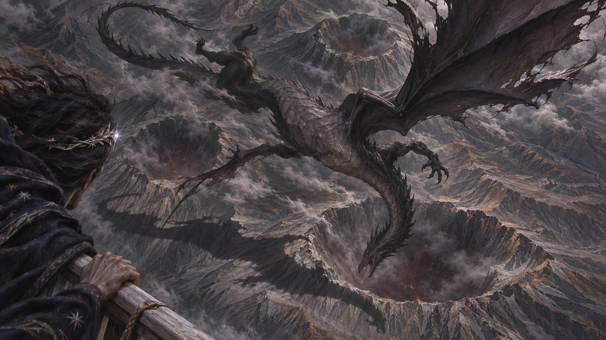

# Middle-earth in the First and Second Ages

AI tools helped research, write, edit, illustrate, and typeset this fan-made sourcebook. The author directed every part of the book, choosing what the chapters cover, how they are ordered, and where the history, adventures, and guidance for gamemasters belong. The author chose which account of Galadriel’s life to follow and how to present Tolkien’s competing accounts of Orc origins while leaving Orcish spirit and free will to each gamemaster. That direction extended to individual figures in the art, including which way Tulkas faces before Manwë and the view over Eärendil’s shoulder as Ancalagon falls.

**[Read the sourcebook online](book/middle-earth-in-the-first-and-second-ages.md)** · [Illustrated PDF](book/middle-earth-in-the-first-and-second-ages.pdf)

At the West-gate of Moria late in the Third Age, the names of Narvi and Celebrimbor are still legible. Knowing who made the doors does the Fellowship little good until someone understands the inscription. In the Second Age a traveler could ask the makers themselves.

Narvi and Celebrimbor are still at work. Someone brings them tools, knows when they quarrel, and is among the first to walk through the door when it opens. There is room in that history for one more person.

## What changes at the table

**First Age.** The Siege of Angband holds for centuries. Someone born far behind the lines might grow old there in peace. After the Battle of Sudden Flame, the same watch-post in Dorthonion can be in enemy hands. The book follows those changes pass by pass. The date determines who can give a traveler shelter, whether a warning can still reach the next valley, and what a lone guard might accomplish by holding the road another hour.

**Second Age.** In Eregion, Annatar has something valuable to teach. A working smith can inspect a join he helped perfect and have excellent grounds to trust his skill. Whether the Valar sent him is another matter. In Umbar, Númenórean fortification brings royal authority into a harbor where local pilots already have duties to ships in distress. This is fertile ground for intrigue. Players can vouch for a teacher, oppose a patron, or give a new institution the custom that its successors will inherit.

**Third Age.** A Dúnadan who wants to know what Isildur did has generations of testimony to sift. Elrond remembers him. Finding a witness, earning a hearing, or recovering the terms of an oath can change what the living have the power to do. The book uses the Third Age as a point of comparison throughout and closes its history with a short account of what survived into it.



*The fall of Ancalagon*, the centerpiece of the illustrated edition.

## What the book provides

- **History and geography for play.** The narrative follows Beleriand from the return of the Noldor to the last havens, then turns to Lindon, Númenor, Eregion, and the Last Alliance. A reference table traces the changing front. Regional entries extend east to the Sea of Rhûn and south to Umbar, Harad, and Khand.
- **Peoples and kindreds.** The family trees trace how the Teleri divided, where the Edain stand among Men, and how the Drúedain, Lossoth, hobbits, and Petty-dwarves fit into the wider histories. The chapter distinguishes kinship with the Eldar and Maiar from the gifts of living or studying among them. [The peoples of Middle-earth](book/middle-earth-in-the-first-and-second-ages.md#the-peoples-of-middle-earth)
- **Magic, craft, and spiritual stature.** Lúthien singing in Angband, a Dwarf singing at the forge, and an oath sworn on the Stone of Erech give a GM three very different precedents. The book considers where each power resides, what another person might learn, and what a witness can actually perceive. The book also takes up the Gift of Men, Finrod and Andreth’s disagreement about death, and how dominion under Morgoth or Sauron affects different peoples.
- **Decisions about Tolkien’s texts.** The register identifies the history adopted for Galadriel and Celeborn, gives sources, and explains the choices. Where a matter belongs to the GM, such as an Orc’s freedom under a master, the book sets out the consequences of different rulings.
- **Material for the GM.** A dedicated section covers solo danger, clues, works of power, and consequences that persist after the traveler leaves. Two sample adventures and a collection of shorter encounters put those ideas into play.

<details>
<summary>Rebuild the illustrated edition</summary>

The [typesetter](book/typeset.py) reads the Markdown manuscript and the illustrations in [art](art/). It runs on Windows with Python 3 and the Times New Roman, Garamond, Palatino Linotype, and Courier New fonts installed in the Windows Fonts directory. From the repository root, run the following commands.

```powershell
py -m pip install reportlab Pillow
py book/typeset.py
```

The script writes the reading edition to `book/middle-earth-in-the-first-and-second-ages.pdf`.

</details>
