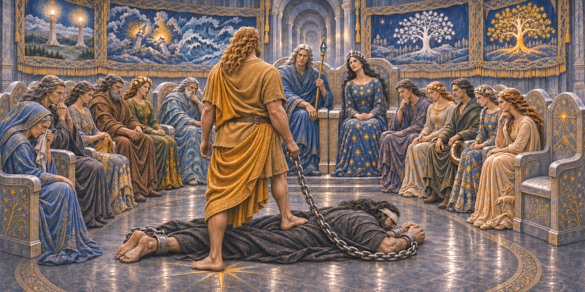
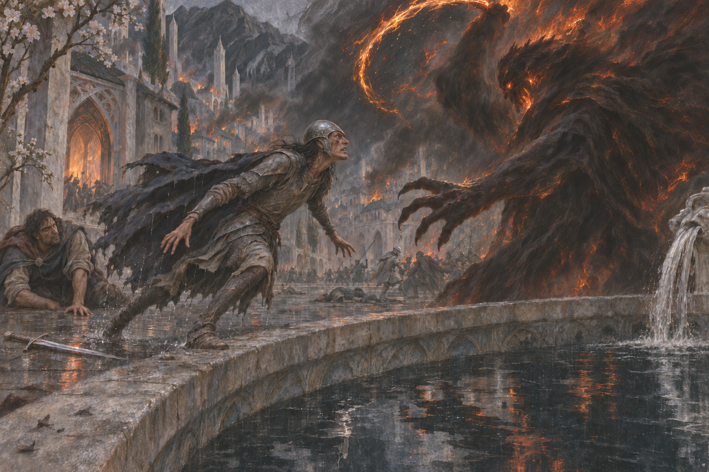
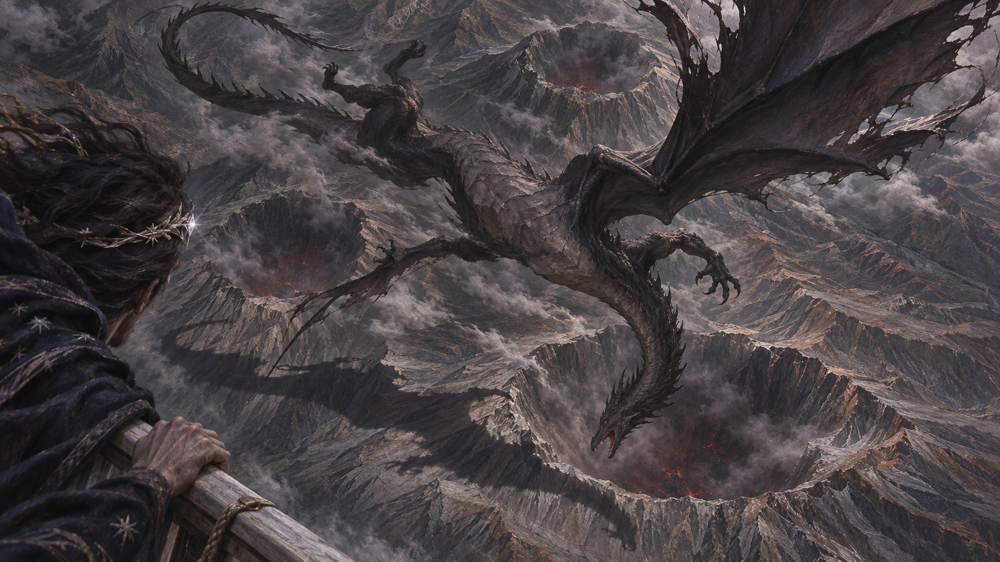
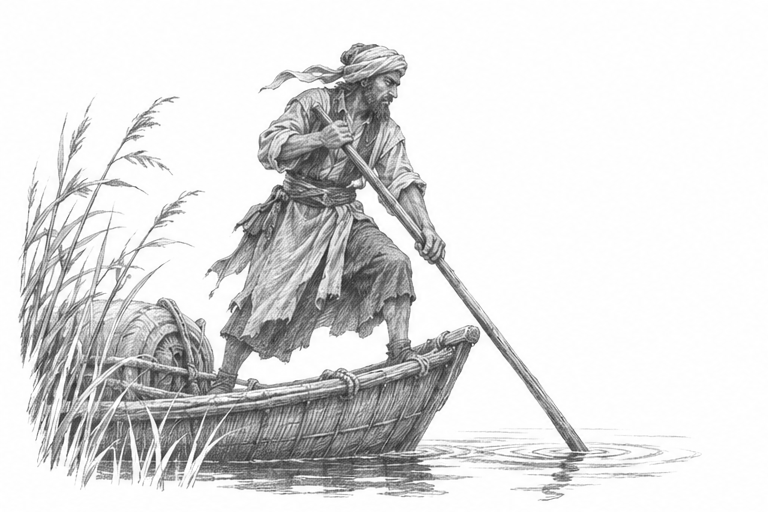
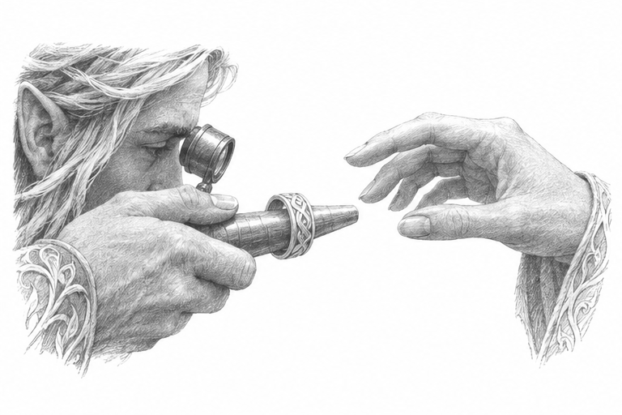
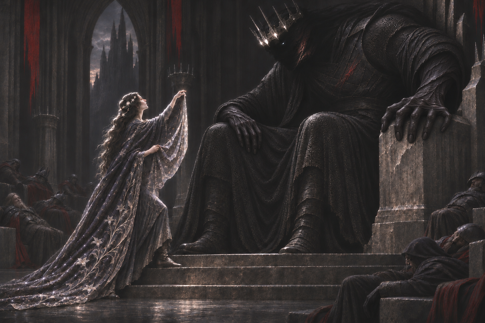
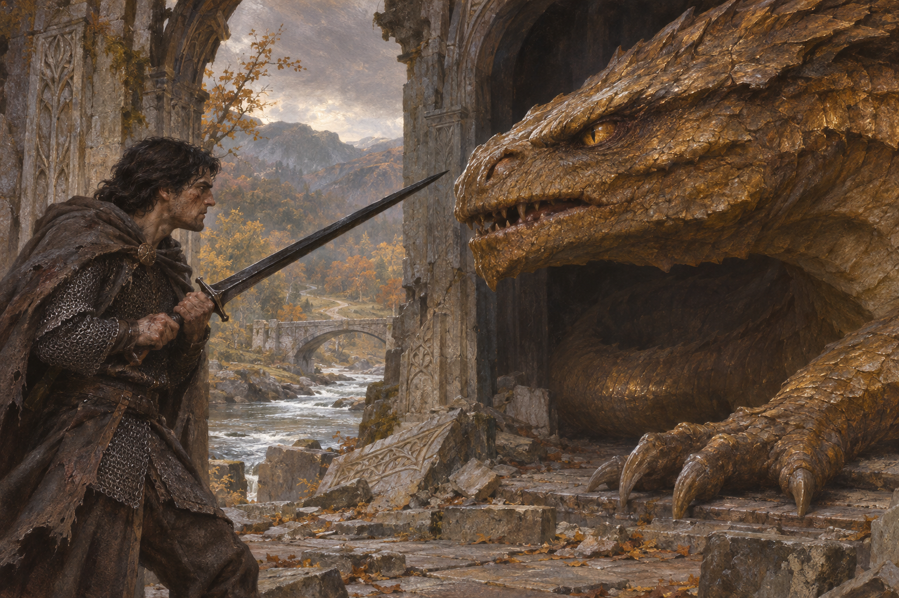
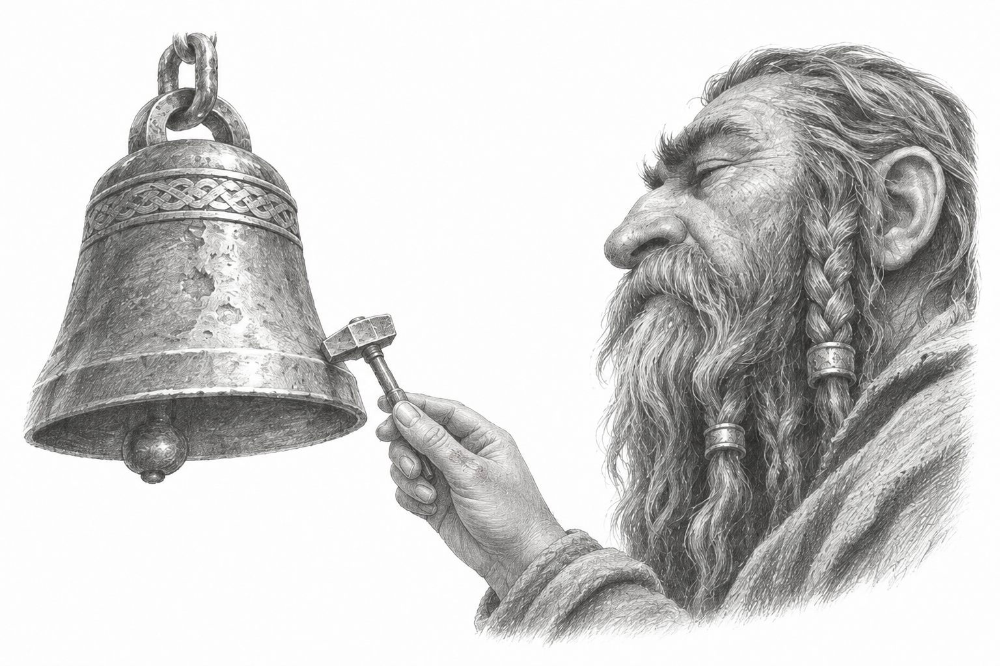
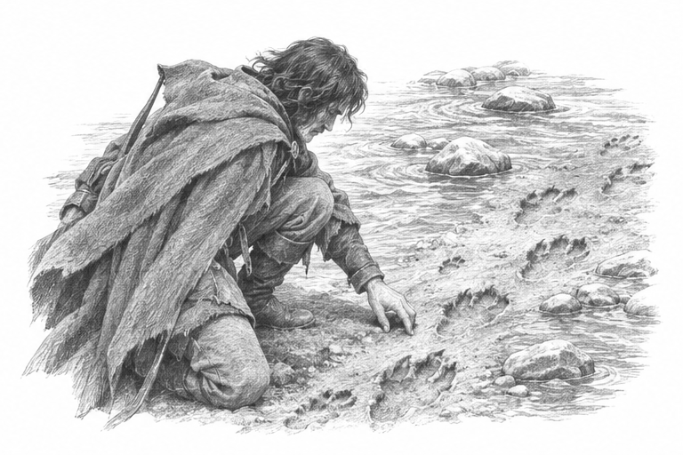

# Middle-earth in the First and Second Ages

AI tools helped research, write, edit, illustrate, and typeset this fan-made sourcebook. The author directed every part of the book, choosing what the chapters cover, how they are ordered, and where the history, adventures, and guidance for gamemasters belong. The author chose which account of Galadriel’s life to follow and how to present Tolkien’s competing accounts of Orc origins while leaving Orcish spirit and free will to each gamemaster. That direction extended to individual figures in the art, including which way Tulkas faces before Manwë and the view over Eärendil’s shoulder as Ancalagon falls.

*A campaign sourcebook*



## About this edition

Narvi and Celebrimbor left their names on the West-gate of Khazad-dûm. To a traveler in the late Third Age they belong to the history of a lost friendship. To a smith in Second Age Eregion they might be the names of two people expected at the forge tomorrow. The earlier Ages give players a chance to know such people while their work is still in hand.

## Using this book

Part One opens with the history of each Age. The later chapters follow its peoples, their arts, and the dangers they face. The adventures begin with [The Bell at the Crossing](#25-the-bell-at-the-crossing). For preparing and running a session, turn to [Guidance for the gamemaster](#guidance-for-the-gamemaster).

**On sources and campaign history.** Tolkien returned to these stories over decades. Two accounts can give the same person different origins, motives, or journeys. This book chooses a continuous history where a meeting or an allegiance depends on it. The register at the back gives the source, the choice, and the reason. To follow a variant yourself, begin with the named chapter, then read Christopher Tolkien’s introduction and notes to the corresponding texts in *Unfinished Tales* or *The History of Middle-earth*. For dates in the Second Age, begin with the headnote and entries of Appendix B to *The Lord of the Rings*.

## Contents

- [About this edition](#about-this-edition)
- [Using this book](#using-this-book)
- [Part One · The world and its peoples](#part-one--the-world-and-its-peoples)
  - [History](#history)
    - [Before the First Age](#before-the-first-age)
      - [1. The Music, the Lamps, and the Trees](#1-the-music-the-lamps-and-the-trees)
    - [The First Age](#the-first-age)
      - [2. Beleriand beneath the stars](#2-beleriand-beneath-the-stars)
      - [3. The return of the Noldor](#3-the-return-of-the-noldor)
      - [4. The Leaguer of Angband](#4-the-leaguer-of-angband)
      - [5. East of the Blue Mountains](#5-east-of-the-blue-mountains)
      - [6. The Battle of Sudden Flame](#6-the-battle-of-sudden-flame)
      - [7. The Battle of Unnumbered Tears](#7-the-battle-of-unnumbered-tears)
      - [8. The fall of the hidden kingdoms](#8-the-fall-of-the-hidden-kingdoms)
      - [9. The War of Wrath](#9-the-war-of-wrath)
        - [The fall of Ancalagon](#the-fall-of-ancalagon)
    - [The Second Age](#the-second-age)
      - [10. Lindon, Númenor, and Greenwood](#10-lindon-númenor-and-greenwood)
      - [11. Eregion and the Rings of Power](#11-eregion-and-the-rings-of-power)
      - [12. The Downfall and the Last Alliance](#12-the-downfall-and-the-last-alliance)
    - [The Third Age](#the-third-age)
      - [13. What the Third Age inherited](#13-what-the-third-age-inherited)
  - [Lands and peoples](#lands-and-peoples)
    - [14. River and road in Rhûn and Harad](#14-river-and-road-in-rhûn-and-harad)
    - [15. Origins and heroic stature](#15-origins-and-heroic-stature)
      - [The peoples of Middle-earth](#the-peoples-of-middle-earth)
      - [Nearness to the Eldar and the Maiar](#nearness-to-the-eldar-and-the-maiar)
    - [16. Professions in Middle-earth](#16-professions-in-middle-earth)
  - [Powers and arts](#powers-and-arts)
    - [17. The Seen and the Unseen](#17-the-seen-and-the-unseen)
    - [18. Embodiment, wounds, and defeat](#18-embodiment-wounds-and-defeat)
      - [Death and the Gift of Men](#death-and-the-gift-of-men)
    - [19. The kinds of magic in Middle-earth](#19-the-kinds-of-magic-in-middle-earth)
    - [20. Traditions of learned magic](#20-traditions-of-learned-magic)
    - [21. Great works, the Rings, and the Marring of Arda](#21-great-works-the-rings-and-the-marring-of-arda)
      - [The dominion of Morgoth and Sauron](#the-dominion-of-morgoth-and-sauron)
    - [22. Traditions and mysteries](#22-traditions-and-mysteries)
    - [23. What the peoples of the two Ages could make](#23-what-the-peoples-of-the-two-ages-could-make)
  - [Adversaries](#adversaries)
    - [24. The forces of darkness](#24-the-forces-of-darkness)
  - [Adventure ideas](#adventure-ideas)
    - [25. The Bell at the Crossing](#25-the-bell-at-the-crossing)
    - [26. A Gift at the Watergate](#26-a-gift-at-the-watergate)
    - [Short adventures](#short-adventures)
- [Part Two · Rules for play](#part-two--rules-for-play)
  - [Guidance for the gamemaster](#guidance-for-the-gamemaster)
    - [27. Running a heroic age](#27-running-a-heroic-age)
      - [Living memory](#living-memory)
      - [One traveler against a greater power](#one-traveler-against-a-greater-power)
      - [A place and its keepers](#a-place-and-its-keepers)
      - [Freedom under a master](#freedom-under-a-master)
    - [28. Witnesses, danger, and consequence](#28-witnesses-danger-and-consequence)
      - [Preparing a discovery](#preparing-a-discovery)
      - [Foresight, oaths, and gifts](#foresight-oaths-and-gifts)
      - [Ruling on a work of power](#ruling-on-a-work-of-power)
      - [After the traveler leaves](#after-the-traveler-leaves)
- [Reference guide](#reference-guide)
  - [The changing front in Beleriand](#the-changing-front-in-beleriand)
  - [The lands at a glance](#the-lands-at-a-glance)
  - [The arts at a glance](#the-arts-at-a-glance)
  - [Reading by encounter](#reading-by-encounter)
- [Register of campaign choices](#register-of-campaign-choices)

## Part One · The world and its peoples

### History

#### Before the First Age

##### 1. The Music, the Lamps, and the Trees

Before there was a sea or a star, Eru Ilúvatar, the creator, gave the Ainur, spirits of his making, a theme to sing. One of them, Melkor, wanted the others to follow his own melody. When the singing ended, Eru showed the Ainur the world their music had foreshadowed, discord and all. Then he gave it being. Some of the singers entered it to shape its seas, mountains and living things. The greatest of these powers were called the Valar. Lesser spirits called Maiar served beside them. Melkor entered too, intending to possess what the others made. [*The Silmarillion*, “Ainulindalë”](https://s3.us-west-1.wasabisys.com/luminist/EB/T/Tolkein%20-%20The%20Silmarillion.pdf)

In the young world, which the Elves called **Arda**, the Valar raised mountains and hollowed out seas. Melkor tore down or twisted their work until Tulkas, strongest of the Valar in body, came to their aid and drove him away. Yavanna planted seeds across Middle-earth. At her request Aulë made two great Lamps, Varda filled them with light, and Manwë hallowed them. **Illuin** stood in the north and **Ormal** in the south. Where their light mingled, on the island of Almaren in a great lake, the Valar made their first home. Forests grew and beasts came forth in the long spring that followed. [“Of the Beginning of Days”](https://ebookscape.com/middle-earth/the-silmarillion-j-r-r-tolkien/)

Melkor returned in secret and dug the fortress of Utumno beneath the northern mountains. Blight spread from it before the Valar knew its source. Then he struck down both Lamps. Their pillars fell, seas broke over the land, and spilled flame swept the earth. Almaren was destroyed. While the Valar laboured to save what life they could, Melkor escaped to Utumno. The Valar crossed the western sea to Aman and established a new home, **Valinor**, behind a wall of mountains. [“Of the Beginning of Days”](https://ebookscape.com/middle-earth/the-silmarillion-j-r-r-tolkien/)

On a green mound in Valinor, Yavanna sang while Nienna watered the earth with her tears. Two Trees grew there. **Telperion** shone silver and **Laurelin** gold. Each waxed as the other waned, and twice in a day their lights mingled. Beyond the mountains and the sea, Middle-earth lay under starlight. Yavanna put many growing things into a long sleep, and Oromë the hunter still rode there against Melkor’s creatures. [“Of the Beginning of Days” and “Of the Coming of the Elves”](https://ebookscape.com/middle-earth/the-silmarillion-j-r-r-tolkien/)

In those early days Aulë, eager for pupils to whom he could teach his crafts, fashioned the first Dwarves. Eru gave them lives of their own, but their fathers had to sleep beneath the mountains until the Elves awoke. Yavanna feared for the forests once peoples with axes should walk in them. In answer she learned that the trees, too, would have shepherds. These were the Ents. [“Of Aulë and Yavanna”](https://ebookscape.com/middle-earth/the-silmarillion-j-r-r-tolkien/)

#### The First Age

##### 2. Beleriand beneath the stars

Varda set new, brighter stars in the sky. Beside Cuiviénen, a lake in the east of Middle-earth, the Elves opened their eyes and saw those stars first. Some had already vanished in the darkness before Oromë found their people. For their protection the Valar went to war. At Utumno, Tulkas wrestled Melkor down. Bound with **Angainor**, the chain Aulë had forged, Melkor was brought blindfolded before Manwë in the Ring of Doom and sentenced to captivity in Mandos. [“Of the Coming of the Elves and the Captivity of Melkor”](https://images.pcmac.org/SiSFiles/Schools/AL/HooverCity/SpainParkHigh/Uploads/DocumentsCategories/Documents/The%20Coming%20of%20Elves%20and%20captivity%20of%20Melkor.pdf)

The Valar invited the Elves to live with them in Valinor. Some chose to remain by the waters where they had awakened. Of the three peoples who set out, the Vanyar and the Noldor first crossed the Blue Mountains into **Beleriand**, the westernmost lands of Middle-earth. The Teleri followed. They were living east of the River Gelion when the sea-lord Ulmo ferried the Vanyar and Noldor west on an island. Many Teleri crossed later with Olwë. Others stayed to search for his missing brother Elwë, or for love of Beleriand’s shores. Elwë had met Melian of the Maiar in a wood. He would rule beside her as King Thingol. [“Of Thingol and Melian” and “Of Eldamar”](https://ebookscape.com/middle-earth/the-silmarillion-j-r-r-tolkien/)

The **Teleri** were the third and largest kindred on the Great Journey. Among their descendants, the **Falmari** sailed west with Olwë. At Alqualondë on the shores of Aman they built their swan-ships. His brother Elwë, called Thingol, remained in Beleriand. The **Sindar**, or Grey-elves, included the mariners of Círdan’s Falas, the people of Mithrim, and the people of Thingol and Melian in Doriath. The **Green-elves** of Ossiriand were another people of Telerin descent. Their Nandorin forebears had broken away earlier on the Journey. [The Silmarillion, Index of Names, under Falmari, Falathrim, Nandor, and Sindar](https://martijn.coppoolse.com/books/part/1237)

In Beleriand, Thingol and Melian received the Dwarves who crossed the Blue Mountains. Together their peoples made Menegroth on the Esgalduin. In the west, Círdan’s mariners built the havens of Brithombar and Eglarest. Far to the east, Denethor led a company of Nandor over the mountains into Ossiriand. All three communities were already there when the Noldor came back. [The Silmarillion, “Of the Sindar”](https://martijn.coppoolse.com/books/part/1217)

##### 3. The return of the Noldor

After long ages of captivity, Melkor sued for pardon and was released. In Valinor he learned of three jewels called the **Silmarils**, in which Fëanor, a prince of the Noldor, had preserved the mingled light of the Trees. Melkor coveted them. With the great spider Ungoliant he destroyed the Trees, whose mingled light survived in the jewels. Melkor murdered Fëanor’s father, stole the Silmarils and fled to Angband, his fortress north of Beleriand. Fëanor named him **Morgoth**. He and his sons swore to reclaim the jewels from anyone who held them. When the Elven mariners at Alqualondë refused them ships, Fëanor’s followers killed many of the mariners and seized their vessels. Fëanor carried his people back to Middle-earth and burned the ships. His half-brother Fingolfin led the host left behind across the grinding ice of the far north. [“Of the Flight of the Noldor”](https://martijn.coppoolse.com/books/part/1216)

As the exiles returned, Yavanna’s song and Nienna’s tears drew one last silver flower from Telperion and a golden fruit from Laurelin. The Valar set them in the sky as the Moon and the Sun. Far away in the east of Middle-earth, Men awoke at the first sunrise. [“Of the Sun and Moon and the Hiding of Valinor”](https://ebookscape.com/middle-earth/the-silmarillion-j-r-r-tolkien/)

The burning ships at Losgar betrayed the landing to Morgoth’s watchers. Fëanor’s host beat back the Orcs that attacked its camp at Mithrim. Fëanor pursued too far and was mortally wounded by Balrogs. By the time Fingolfin reached the lake with the people he had led across the ice, the sons of Fëanor held the other camp. The followers of the two houses had a common enemy and every reason to distrust one another. [The Silmarillion, “Of the Return of the Noldor”](https://martijn.coppoolse.com/books/part/1220)

The person who did most to mend that breach was Fingon. He went north in search of Maedhros, whom Morgoth held captive, and brought him back with the aid of Thorondor. Maedhros yielded the high kingship to Fingolfin. When messengers crossed between the two camps again, they did so on the strength of a friendship older than the burning at Losgar. [The Silmarillion, “Of the Return of the Noldor”](https://martijn.coppoolse.com/books/part/1220)

After the first battle in Beleriand, Melian set her Girdle about the forests of Neldoreth and Region. Within it the court at Menegroth, the teaching of Melian, and the leave required to enter shaped life in Doriath. On the coast, the Falathrim lived by fishing, shipbuilding, and passage between the havens. A pilot from Eglarest and a marchwarden from Doriath might speak Sindarin to one another and still need a guide in each other’s country. [The Silmarillion, “Of the Sindar”](https://martijn.coppoolse.com/books/part/1217)

Galadriel defended the mariners at Alqualondë. Their king Olwë was her mother Eärwen’s father. Innocent of the Kinslaying, she nevertheless went into exile with her kin and accepted the Doom of the Noldor. In Beleriand she came to Doriath and learned from Melian. There she met Celeborn, a Sindarin prince of Thingol’s kin. [Unfinished Tales, “The History of Galadriel and Celeborn”](https://ebookscape.com/middle-earth/unfinished-tales-j-r-r-tolkien/)

##### 4. The Leaguer of Angband

The watch began with a victory. At Dagor Aglareb, Orcs struck through the Pass of Sirion in the west and Maglor’s country in the east. Fingolfin and Maedhros caught the main host between them and pursued it across Ard-galen to the gates of Angband. The princes strengthened their watch. For nearly four hundred years a rider on the northern plain could look up and see Thangorodrim. The gates at its foot remained in Morgoth’s hands. [The Silmarillion, “Of the Return of the Noldor”](https://martijn.coppoolse.com/books/part/1220)

The watch had depth. Fingolfin held Hithlum behind the Ered Wethrin. From Dorthonion the sons of Finarfin watched the plain. In the east, Maedhros held Himring above the passes, while Maglor’s riders covered open country that rock walls could never close. Orcs still found ways around the watch. Once they came down the coast and tried to enter Hithlum from the west. A family living far behind the northern camps could still wake to a warning from the sea. [The Silmarillion, “Of the Return of the Noldor”](https://martijn.coppoolse.com/books/part/1220)

Elsewhere in Beleriand a lifetime could pass in peace. A courier leaving Menegroth for the Falas began among beech woods where a king’s leave opened the ways. At Eglarest, leave to sail counted for little if the tide had turned. An Elven guest who had seen the Girdle raised might still have to sit on the quay until a young pilot judged the harbor mouth safe. Both were among the Sindar. [The Silmarillion, “Of the Sindar”](https://martijn.coppoolse.com/books/part/1217)

During these years Galadriel and Celeborn married in Doriath. Menegroth was their home while the leaguer held. Galadriel learned from Melian, and her kin in other Noldorin realms could bring news into Thingol’s court. A mortal envoy who met the couple in these years might be remembered there generations later. [Unfinished Tales, “The History of Galadriel and Celeborn”](https://ebookscape.com/middle-earth/unfinished-tales-j-r-r-tolkien/)

Generations after the first sunrise, some peoples of Men crossed the Blue Mountains and settled among the Elves. These allies became known as the **Edain**. An Elven lord who took a mortal warrior into his service might one day ride beside her great-grandchildren. [“Of the Coming of Men into the West”](https://martijn.coppoolse.com/books/part/1224) · [“Of the Ruin of Beleriand”](https://martijn.coppoolse.com/books/part/1225)

##### 5. East of the Blue Mountains

The wars about Angband fill the annals kept in Beleriand. A different history survives along the inland waterways. Among the forebears of Hador’s people were boatbuilders who learned to cross a rough inland sea. On its farther shore they encountered people whose speech betrayed an old kinship. By the time some of their descendants reached the Blue Mountains, they had already left places and people behind. [The Peoples of Middle-earth, “Of Dwarves and Men”](https://tolkiengateway.net/wiki/Of_Dwarves_and_Men)

**Eriador before the drowning.** During the Long Peace, some of Amlach’s people chose a new leader and crossed back east over the Blue Mountains. The western annals lose track of them there. A traveler can therefore meet Men in First Age Eriador well before refugees from Beleriand arrive. The record gives no settlement names or population figures for these returnees. [The Silmarillion, “Of the Coming of Men into the West”](https://martijn.coppoolse.com/books/part/1224)

**The land later called Mordor.** A late note traces Orodruin and its eruptions to Melkor’s devastation during the long First Age. It gives neither the date the mountain rose nor a stronghold or forge that Morgoth kept there. In a Gondorian account, the Drúedain traveled from lands south of this region, turned north into Ithilien, and crossed Anduin. That tradition locates people on the southern and western approaches. The inhabitants of the basin around Núrnen in this period remain unnamed. [The Peoples of Middle-earth, “Last Writings,” note 14, excerpted in Other Minds no. 1, p. 13](https://www2.omzine.org/downloads/om-english/om-001-Other_Minds_Magazine_Issue_001_revision_20080203.pdf) · [Unfinished Tales, “The Drúedain”](https://ebookscape.com/middle-earth/unfinished-tales-j-r-r-tolkien/)

Farther west along the southern approaches, the account preserved by the Drúedain’s neighbors follows people across Anduin into the vales of the White Mountains. It is a history of movement remembered in Gondor long afterwards. The names of early rulers of the basin beyond the mountains have not come down with it. [Unfinished Tales, “The Drúedain”](https://ebookscape.com/middle-earth/unfinished-tales-j-r-r-tolkien/)

##### 6. The Battle of Sudden Flame

In winter, fire poured from Thangorodrim onto Ard-galen. Men and horses died in the camps. The grassland that had fed the northern watch became Anfauglith, a waste of choking dust. A rider escaping south could no longer count on grazing or on finding the company whose fires he had seen the night before. This was the Dagor Bragollach, the Battle of Sudden Flame. [The Silmarillion, “Of the Ruin of Beleriand and the Fall of Fingolfin”](https://martijn.coppoolse.com/books/part/1225)

Dorthonion fell. In the east Glaurung went through Maglor’s Gap and the survivors came in to Maedhros on Himring. The hill held, and for a time Maedhros even closed the Pass of Aglon again. Word of those successes had scarcely any comfort for Fingolfin in Hithlum when he heard the extent of the losses. He rode alone to Angband, wounded Morgoth, and died before its gates. [The Silmarillion, “Of the Ruin of Beleriand and the Fall of Fingolfin”](https://martijn.coppoolse.com/books/part/1225)

The western road changed hands later. For nearly two years the tower of Minas Tirith on Tol Sirion held the pass. Then Sauron drove out Orodreth and occupied the island. Where a scout could once have reported to a friendly garrison, the enemy could now mark her passage. The island became Tol-in-Gaurhoth, the Isle of Werewolves. [The Silmarillion, “Of the Ruin of Beleriand and the Fall of Fingolfin”](https://martijn.coppoolse.com/books/part/1225)

It was Lúthien and Huan who eventually forced Sauron to give up the tower. In Angband itself, Lúthien won time for Beren to cut a Silmaril from Morgoth’s crown. Their escape gave Maedhros reason to believe that a united assault might succeed where the siege had failed. [The Silmarillion, “Of Beren and Lúthien”](https://martijn.coppoolse.com/books/part/1226) · [The Silmarillion, “Of the Fifth Battle”](https://martijn.coppoolse.com/books/part/1227)

##### 7. The Battle of Unnumbered Tears

Fingon mustered at Eithel Sirion in the west. Maedhros raised his standard in the east. Turgon brought an army out of hidden Gondolin. For a moment forces long divided were in the field together. The eastern host was delayed, and the treachery of Uldor struck when the armies most needed one another. The name the survivors gave the battle was Nirnaeth Arnoediad, Unnumbered Tears. [The Silmarillion, “Of the Fifth Battle”](https://martijn.coppoolse.com/books/part/1227)

Fingon was killed. Húrin and Huor with the Men of Dor-lómin held the rear while Turgon led survivors down the Pass of Sirion. Huor fell. Húrin was taken alive. Their stand preserved the retreat to Gondolin, but the families they left in Dor-lómin soon lived under occupation. A safe way out of the battle had become a road by which few could ever go home. [The Silmarillion, “Of the Fifth Battle”](https://martijn.coppoolse.com/books/part/1227)

Círdan’s walled havens still received refugees, and his ships could strike along the coast. The next year an army came down the rivers Brithon and Nenning. Brithombar and Eglarest fell. From then on a fugitive reaching the old quays needed a passage to Balar or the havens at the mouths of Sirion. The sea route outlasted the towns that had served it. [The Silmarillion, “Of the Fifth Battle”](https://martijn.coppoolse.com/books/part/1227)

##### 8. The fall of the hidden kingdoms

With the northern armies broken, three kingdoms survived for different reasons. The doors of Nargothrond could be concealed, the paths into Doriath could bewilder an enemy, and few outside Gondolin knew the way to its valley. Each defense failed in its own fashion.

At Nargothrond an army that had once relied on secrecy sought open battle. The bridge across the Narog, broad enough for that army to issue forth, gave Glaurung a crossing when it was defeated. Túrin reached the gates in time to see the people led away and stood helpless under the dragon’s gaze. A bridge once hailed as a work of strength had put an end to the protection of the river. [The Silmarillion, “Of Túrin Turambar”](https://martijn.coppoolse.com/books/part/1228)

In Doriath the decisive losses came from within the history of the Silmaril. Thingol was killed and Melian departed. After the sack of Menegroth, Dior returned for a time. Fëanor’s sons attacked their own kindred for the jewel. Elwing escaped to the mouths of Sirion. A refugee from Doriath had different enemies and a different story from a captive taken at Nargothrond. [The Silmarillion, “Of the Ruin of Doriath”](https://ebookscape.com/middle-earth/the-silmarillion-j-r-r-tolkien/)

At Gondolin, Maeglin gave Morgoth the secret of the city. When its defenses broke, Ecthelion faced Gothmog at the King’s Fountain. The escape of Tuor, Idril, and their son Eärendil owed much to the way Idril had prepared in secret. Survivors made for the mouths of Sirion, where Elwing had taken refuge. [The Silmarillion, “Of Tuor and the Fall of Gondolin”](https://martijn.coppoolse.com/books/part/1230)



*Ecthelion at the King’s Fountain.* Wounded and disarmed, Ecthelion casts himself against Gothmog. Both fall into the deep basin. [The Fall of Gondolin, “The Original Tale”](https://www.ebookscape.com/middle-earth/the-fall-of-gondolin-j-r-r-tolkien/)

##### 9. The War of Wrath

At the mouths of Sirion, families from fallen kingdoms made a haven together. When the sons of Fëanor came after the Silmaril once more, even that last mainland refuge failed. Elwing reached Eärendil with the jewel. For the people left on the shore there was no army of Beleriand to summon and no northern line to restore. [The Silmarillion, “Of the Voyage of Eärendil and the War of Wrath”](https://martijn.coppoolse.com/books/part/1231)

By the light of the Silmaril, Elwing and Eärendil crossed the sea to Valinor. There Eärendil pleaded for Elves and Men together. The host of the West answered him, and for the first time since the siege broke, the war came back to Morgoth’s own gates. [“Of the Voyage of Eärendil and the War of Wrath”](https://martijn.coppoolse.com/books/part/1231)

When Morgoth sent winged dragons out of Angband, even the host of the West gave ground. Eärendil fought from Vingilot with the great birds beside him and cast down Ancalagon upon Thangorodrim. The peaks broke beneath him. Morgoth was taken and cast out of the world. Much of Beleriand broke apart and sank. When a Second Age Elf speaks of visiting her childhood home, she may mean sailing over it. [The Silmarillion, “Of the Voyage of Eärendil and the War of Wrath”](https://martijn.coppoolse.com/books/part/1231)

###### The fall of Ancalagon



*The War of Wrath.* The Silmaril shines on Eärendil’s brow. Beneath his ship, Ancalagon falls upon Thangorodrim and breaks its towers. The dragon’s span and the moment of his tumble are the painting’s interpretation. [The Silmarillion, “Of the Voyage of Eärendil and the War of Wrath”](https://martijn.coppoolse.com/books/part/1231)

#### The Second Age

##### 10. Lindon, Númenor, and Greenwood

The survivors made new homes. Gil-galad, High King of the Noldor, ruled **Lindon** on the surviving western coast. From its Grey Havens Elves could sail into the West. The Edain received **Númenor**, a great island between Middle-earth and Valinor. Its first king was Elros, son of Eärendil and Elwing. Given a choice of kindreds, Elros chose a mortal life. His brother Elrond chose the life of the Elves. For thousands of years Elrond could meet the descendants of a brother he still remembered. Númenor’s people, the **Dúnedain**, lived far longer than other Men, but even their kings had to die. [*Akallabêth*](https://martijn.coppoolse.com/books/part/1232)

Galadriel and Celeborn remained in Middle-earth after the war and lived for a time in Lindon south of the Lune. Galadriel believed the Doom of the Noldor still lay on her. Centuries later, when she refused the Ring that Frodo freely offered, that burden was lifted. [The Lord of the Rings, Appendix B, “The Second Age”](https://theallfreenovel.com/130/33/the_return_of_the_king.amp) · [Unfinished Tales, “The History of Galadriel and Celeborn,” including “The Sindarin Princes of the Silvan Elves”](https://ebookscape.com/middle-earth/unfinished-tales-j-r-r-tolkien/)

**The people of Greenwood.** East of the Misty Mountains the Silvan Elves already had their own speech and woodland life. In the tradition followed here, Oropher came from ruined Doriath with a small Sindarin company. They learned the local language and took names in Silvan fashion. Oropher became king. He fell in the War of the Last Alliance, and his son Thranduil brought the survivors home. Thranduil’s later halls recall Menegroth. The people who built and used them had a history in Greenwood long before his family arrived. [Unfinished Tales, “The History of Galadriel and Celeborn,” including “The Sindarin Princes of the Silvan Elves”](https://ebookscape.com/middle-earth/unfinished-tales-j-r-r-tolkien/)

Along the Anduin a household that had never seen the sea might now welcome a traveler who had lost a whole coastline. Oropher and the Sindar who came east carried memories of Thingol’s realm. In Greenwood the newcomers had to learn the names by which their hosts knew the streams and clearings. The long history of that encounter belongs to both peoples. [Unfinished Tales, “The History of Galadriel and Celeborn”](https://ebookscape.com/middle-earth/unfinished-tales-j-r-r-tolkien/)

##### 11. Eregion and the Rings of Power

In Middle-earth, Elven smiths settled **Eregion**, beside the western gate of the Dwarf-realm of **Khazad-dûm**. The Dwarves had mithril, a rare silvery metal, and the two peoples shared a love of craft. Their friendship can be read on the gate itself. Narvi the Dwarf made the doors and Celebrimbor the Elf drew their signs. Celebrimbor was Fëanor’s grandson. When a stranger calling himself **Annatar**, the Lord of Gifts, offered to teach the smiths, he found people eager to learn. The promise that mattered most to them was preservation. An Elf could live to see a beloved wood cut down or a city vanish. [“A Journey in the Dark”](https://bookwise.io/j-r-r-tolkien/the-lord-of-the-rings-volume-1) · [“Of the Rings of Power”](https://martijn.coppoolse.com/books/part/1233)

An Elf approaching the West-gate from the holly woods saw trees and stars drawn on the stone. The lettering named Narvi, who made the doors, and Celebrimbor, who drew the signs. A Dwarven porter and an Elven visitor could read their friendship there. When warnings came from Lindon about the stranger in Celebrimbor’s workshop, they came to a people with good reasons to welcome a skilled guest. [The Silmarillion, “Of the Rings of Power and the Third Age”](https://martijn.coppoolse.com/books/part/1233)

Annatar was **Sauron**, one of the Maiar and once Morgoth’s most trusted servant. With his teaching the smiths made Rings of Power. Celebrimbor made the Three Elven Rings himself. About the year **1600** of the Second Age, Sauron forged the One Ring in Mordor, his realm in the southeast. Through it he meant to govern the minds of those who wore the others. When he first put it on, the Elves perceived him in turn and took off their rings. Having failed by persuasion, Sauron came with an army. In **1697** Eregion fell, Celebrimbor was killed, and Elrond founded the refuge later called Rivendell. [“Of the Rings of Power”](https://martijn.coppoolse.com/books/part/1233) · [*The Lord of the Rings*, Appendix B](https://theallfreenovel.com/130/33/the_return_of_the_king.amp)

The Three remained hidden. Seven Rings came to Dwarf-lords. Their hunger for treasure grew, though Sauron could never bend them fully to his will. Nine mortal Men gained power and long life, gradually faded from sight, and became the **Nazgûl**, the Ringwraiths bound to Sauron. A Númenórean fleet helped save Lindon. Farther east and south, many peoples still lived under Sauron’s rule. [“Of the Rings of Power”](https://martijn.coppoolse.com/books/part/1233) · [*The Lord of the Rings*, Appendix B](https://theallfreenovel.com/130/33/the_return_of_the_king.amp)

**The pass before the Dark Tower.** Shelob had taken shelter in the western mountains before Sauron settled in Mordor. She served herself. Her victims included Elves and Men, though their homes and the date of her arrival are unrecorded. About S.A. 1000 Sauron chose Mordor as his stronghold and began Barad-dûr. Orodruin supplied fire for sorcery and forging. About S.A. 1600 he completed the tower and made the One Ring. [The Two Towers, “Shelob’s Lair”](https://bookwise.io/j-r-r-tolkien/the-lord-of-the-rings-volume-2) · [The Lord of the Rings, Appendix B, “The Second Age”](https://theallfreenovel.com/130/33/the_return_of_the_king.amp) · [The Silmarillion, “Of the Rings of Power and the Third Age”](https://martijn.coppoolse.com/books/part/1233)

##### 12. The Downfall and the Last Alliance

Generations of mainlanders had welcomed Númenórean mariners as teachers and friends. Later kings demanded timber and tribute. At the southern haven of Umbar they built a fortress. At home, many Númenóreans had come to envy the Elves their immortality. When King Ar-Pharazôn brought Sauron home as a prisoner, Sauron turned that fear to his advantage. He persuaded the king that he could win life everlasting by conquering Valinor. In **3319** the king sailed west with an armada. Eru intervened. The sea swallowed Númenor, and Valinor passed beyond the reach of ordinary ships. [*Akallabêth*](https://martijn.coppoolse.com/books/part/1232) · [*The Lord of the Rings*, Appendix B](https://theallfreenovel.com/130/33/the_return_of_the_king.amp)

Among those who had remained friends of the Elves were Elendil and his sons. They led their people to safety by sea. In Middle-earth they founded **Arnor** in the north and **Gondor** in the south. Sauron also survived and returned to Mordor. When he attacked Gondor, Gil-galad and Elendil brought their peoples together in the **Last Alliance of Elves and Men**. After seven years of siege, both kings died in the struggle that overthrew Sauron. Isildur, Elendil’s son, cut the One Ring from Sauron’s hand and kept it in recompense for his slain father and brother. The Second Age ended in **3441**. The Ring survived into the Third. [“Of the Rings of Power and the Third Age”](https://martijn.coppoolse.com/books/part/1233)

The siege of Barad-dûr ended with the tower thrown down. Its foundations endured. For a Dúnadan who had survived the Downfall and the siege, the ruin could be measured stone by stone. The One Ring carried away by Isildur left the settlement of that war unfinished. [The Silmarillion, “Of the Rings of Power and the Third Age”](https://martijn.coppoolse.com/books/part/1233)

#### The Third Age

##### 13. What the Third Age inherited

In Rivendell a guest could speak to Elrond about the Last Alliance and hear an eyewitness. For the Dúnedain, the same war lay many generations back. They kept the names of the dead and the terms of old promises. That difference in living memory shapes three encounters late in the Age.

At the Ford of Bruinen, Elrond called up the river against the Riders. Frodo, close to passing into the Unseen, saw Glorfindel shining on the bank. In Lórien he later offered Galadriel the One Ring. She refused it, and the burden she had carried since the exile of the Noldor lifted. Here the tale begun at Alqualondë reaches its end. [The Fellowship of the Ring, “Many Meetings” and “The Mirror of Galadriel”](https://bookwise.io/j-r-r-tolkien/the-lord-of-the-rings-volume-1)

In the south Aragorn came to the Stone of Erech, where the King of the Mountains had sworn to Isildur. He could name the service still owed and, as Isildur’s heir, release the Dead when they fulfilled it. At the end of the war the One Ring was destroyed and the foundations that the Last Alliance had been unable to break went down with Barad-dûr. [The Return of the King, “The Passing of the Grey Company” and “Mount Doom”](https://bookwise.io/j-r-r-tolkien/the-lord-of-the-rings-volume-3)

### Lands and peoples

#### 14. River and road in Rhûn and Harad

##### Rhûn and the eastern lands

Rhûn means *East* in Sindarin. The Celduin runs into the Sea of Rhûn on the familiar map. Tolkien also gives the East a history of its own. In one Second Age note, some eastern Orcs laugh at Sauron in his fair form. His emissaries are already at work among eastern Men, and he still has peoples to persuade or subdue. Khamûl, one of the Nine, is called the Shadow of the East. His mortal home and the circumstances in which he accepted a Ring are unrecorded. [Sea of Rhûn and the Celduin](https://www.encyclopedia-of-arda.com/s/seaofrhun.php) · [“Note on the Delay of Gil-galad and the Númenóreans”](https://tolkiengateway.net/wiki/Eastern_Orcs) · [*Unfinished Tales*, “The Hunt for the Ring”](https://ebookscape.com/middle-earth/unfinished-tales-j-r-r-tolkien/)

The following eastern and southern homelands are original campaign settings. Their English names translate the names used by their inhabitants.



In the Lower River the first soundings after a flood matter to the whole shore. The pilot takes the boat out at dawn, feeling for the old channel with her pole. Before she has marked a new one, word comes down from the Copper Hills that water has entered a mine. The crown owns the hearths there, the mining families own the galleries, and neither can tell her which families can still get out by road. The boat that carried ore yesterday goes back upriver carrying people.

Farther inland the Meeting Pastures bring several valleys together each spring. An agreement made there can be remembered by witnesses who return home to different rivers. These local ties give news a route from the hills to the lake long before a royal courier appears. The local names and the flooded mine are creations of this campaign.

##### Harad and the southern lands

Umbar has an excellent harbour long before Númenor makes it a fortress in S.A. 2280. Farther south, the histories occasionally preserve names. In the late Second Age, Herumor and Fuinur are Númenórean lords who rise to power among the Haradrim. Tolkien leaves their seats and the extent of their rule unspecified. Near Harad and Far Harad are broad western geographic terms. Khand has its own entry southeast of Mordor. Its allegiances are better recorded in the Third Age. [Appendix B, “The Second Age”](https://theallfreenovel.com/130/33/the_return_of_the_king.amp) · [“Of the Rings of Power and the Third Age”](https://martijn.coppoolse.com/books/part/1233/of-the-rings-of-power-and-the-third-age) · [*The Return of the King*, “The Battle of the Pelennor Fields”](https://www.ebookscape.com/middle-earth/the-return-of-the-king-j-r-r-tolkien/)

At Umbar the pilots’ obligation is older than the garrison. When a vessel signals in bad weather, a crew from the headland puts out. Their neighbors provide for the families of those who fail to come home. The first time the garrison closes the harbor during a storm, an order from the fortress reaches straight into that old agreement. Beyond the coast, the households of the Fig Vale have duties just as exacting. A keeper who gives away another household’s irrigation turn may cost it a season’s fruit.

#### 15. Origins and heroic stature

An Elf who remembers the Trees can testify to a light most of her kindred have never seen. At the West-gate of Khazad-dûm, a young Dwarf apprenticed to a mason may know more than she does about the fit of the doors. In a haven of Númenor, a pilot may remember the grandfather of a mainland ruler as a boy. The pilot remembers what the grandfather promised. The young ruler knows her only as a stranger from across the sea.

An Elf can teach for centuries and still feel the slow fading of her embodied life. Learning, memory, and the light a Rider perceives in her each have their own history. Knowledge of a song can pass from master to pupil. The memory of hearing it sung beneath the Trees belongs to the witness.

##### The peoples of Middle-earth

A mariner from Alqualondë and a marchwarden of Doriath can both claim Telerin kin. One grew up among the swan-ships in Aman. The other knows the ways through Melian’s Girdle. A family tree explains their kinship. It takes a history to explain why their lives are so different. The three trees below follow selected peoples through the Ages. Some branches mark a migration or an alliance. The account below identifies where those histories cross.

**Elves.** At Cuiviénen the decisive question was whether to follow Oromë west. The Eldar undertook the Great Journey. The Avari declined. An older account of clan descent uses another set of names. The Minyar went west as the Vanyar. Among the Tatyar and Nelyar, some stayed and some set out. Their westbound hosts became the Noldor and the Teleri respectively. An Avar could therefore have kin among the Eldar who departed. [*The Silmarillion*, “Of the Coming of the Elves” and “The Sundering of the Elves”](https://s3.us-west-1.wasabisys.com/luminist/EB/T/Tolkein%20-%20The%20Silmarillion.pdf) · [*The War of the Jewels*, “Quendi and Eldar,” section C](https://groups.google.com/g/alt.fan.tolkien/c/nhD0kM1e2HM)

```text
Elves (Quendi)
├─ Avari · declined the summons
└─ Eldar · took the westward road
   ├─ Vanyar
   ├─ Noldor
   └─ Teleri
      ├─ Falmari · crossed the Sea
      ├─ Sindar · remained in Beleriand
      │  ├─ Falathrim of the havens
      │  ├─ the people of Doriath
      │  └─ the Grey-elves of Mithrim
      └─ Nandor · turned aside earlier
         ├─ Green-elves of Ossiriand
         └─ kin of the Silvan Elves
```

Olwë’s Falmari reached Aman. Círdan’s Falathrim also loved the sea and built ships, yet they belonged to the Sindar. Within Doriath the Girdle sheltered a court and woodland communities that developed apart from the coastal havens. The Nandor had left the march farther east. Denethor led some of their people into Ossiriand. Others belonged to the woodland history from which the Silvan peoples emerged. When Oropher came to Greenwood, a small Sindarin company joined a much larger Silvan population. Thranduil inherited his father’s kingship among people whose forebears already knew the forest. [*The Silmarillion*, index entries for Falmari, Falathrim, Sindar, and Nandor](https://martijn.coppoolse.com/books/part/1237) · [*Unfinished Tales*, “The Sindarin Princes of the Silvan Elves”](https://ebookscape.com/middle-earth/unfinished-tales-j-r-r-tolkien/)

*Calaquendi* describes a different experience. The name belongs to those who had seen the light of the Trees. Thingol had visited Aman as an ambassador before the march. He counted among the Elves of the Light and was king of the Sindar. His subjects in Doriath could know Melian personally without ever having seen the Trees themselves. [*The Silmarillion*, “Of Thingol and Melian”](https://s3.us-west-1.wasabisys.com/luminist/EB/T/Tolkein%20-%20The%20Silmarillion.pdf)

**Men, the Edain, and the Dúnedain.** In Elvish lore *Atani* can embrace all humankind. In the histories of Beleriand its Sindarin form *Edain* usually identifies the mortal Elf-friends of three houses. The distinction matters. Bëor entered Finrod’s service. Hador received Dor-lómin from Fingolfin. Haleth’s people kept their own leaders in Brethil. Common Men elsewhere had no share in those grants or obligations simply by being human. They had their own rulers, trades, and traditions, including the many peoples of the East and South. [*The Silmarillion*, “Of the Coming of Men into the West”](https://martijn.coppoolse.com/books/part/1224)

```text
Men (humankind)
├─ The Three Houses of the Edain
│  ├─ House of Bëor
│  ├─ House of Haleth
│  └─ House of Hador
├─ Drúedain · also counted as Edain
├─ Hobbits
│  ├─ Harfoots
│  ├─ Stoors
│  └─ Fallohides
├─ Forodwaith of the far north
│  └─ Lossoth of Forochel
└─ Many other mortal peoples
```

The Edain who sailed after the War of Wrath became the founding people of Númenor. The Dúnedain, the Men of the West, received an extraordinary span of vigorous life. A mainland family might count three successions during the career of one Númenórean captain. The royal house had a further inheritance through Elros, brother of Elrond and descendant of Lúthien. Elros chose the fate of Men. His ancestry follows his family line. The gift of long life reached the wider people of the island. [*The Silmarillion*, “Akallabêth”](https://martijn.coppoolse.com/books/part/1232) · [*Unfinished Tales*, “The Line of Elros”](https://ebookscape.com/middle-earth/unfinished-tales-j-r-r-tolkien/)

The **Drúedain** lived as a distinct people among the Folk of Haleth. Their Elvish name acknowledged them among the Edain. In Brethil their neighbors learned tracking from them. In the tale of the Faithful Stone, Aghan leaves a carved guardian to watch over his friend Barach’s house. A few Drúedain also appear in traditions of early Númenor. Their short lives and the power of their own arts make them particularly important to the history of mortal gifts. [*Unfinished Tales*, “The Drúedain,” including “The Faithful Stone” and note 7](https://ebookscape.com/middle-earth/unfinished-tales-j-r-r-tolkien/)

**Hobbits** belong to Men. Harfoots, Stoors, and Fallohides are the three strains remembered in their later history. Their oldest traditions look back to the Anduin. No secure First or Second Age date locates a particular hobbit household on its banks. [Tolkien’s letter to Milton Waldman, 1951](https://www.tolkienestate.com/letters/letter-to-milton-waldman-publisher-1951/) · [*The Fellowship of the Ring*, Prologue, “Concerning Hobbits”](https://www.mrsmuellersworld.com/uploads/1/3/0/5/13054185/tolkien_-_fellowship_of_the_ring.pdf)

The **Lossoth** of Forochel are a surviving people of the ancient Forodwaith. When Arvedui fled north in the Third Age, it was the Lossoth who could feed his company through the winter. Their chief knew what ice and wind might do to a ship in that bay. The king left against his advice. That encounter supplies a name, a place, and a body of northern knowledge. The extent of the ancestral Forodwaith’s settlements in either earlier Age remains unrecorded. [*The Lord of the Rings*, Appendix A, “The North-kingdom and the Dúnedain,” including the note on the Lossoth](https://rsd2-alert-durden-reading-room.weebly.com/uploads/6/7/1/6/6716949/03-the-return-of-the-king.pdf)

**Dwarves.** Aulë fashioned the first Fathers of the Dwarves, and Eru gave them independent life. The seven kindreds trace their origins to those Fathers. Durin’s Folk are one of the seven. *Petty-dwarves* is a name for Dwarves descended from exiles of the eastern cities. It describes a history of dispossession within Dwarvenkind. Mîm and his sons kept a home at Amon Rûdh long after their people first came west. [*The Silmarillion*, “Of Aulë and Yavanna” and “Of Túrin Turambar”](https://s3.us-west-1.wasabisys.com/luminist/EB/T/Tolkein%20-%20The%20Silmarillion.pdf) · [*The Children of Húrin*, “Of Mîm the Dwarf”](https://www.ebookscape.com/middle-earth/the-children-of-hrin-j-r-r-tolkien/)

```text
Dwarves (Khazâd)
└─ Seven kindreds, including Durin’s Folk
   └─ Exiles from the eastern cities
      └─ Petty-dwarves of Beleriand
         └─ Mîm and his sons, Ibun and Khîm
```

Only the line leading to Mîm is expanded here. The texts give Mîm a Dwarven ancestry without assigning his family to a named founding house. Orcish origins are treated separately under [Orcs, spirit, and free will](#orcs-spirit-and-free-will).

##### Nearness to the Eldar and the Maiar

In this campaign, closer kinship with the Eldar and the Maiar, life among them, and instruction from them tend to confer greater power. Each relationship confers something particular. Lúthien is Melian’s daughter and her voice can lay Morgoth asleep. Galadriel lived in the light of the Trees and learned from Melian in Doriath. Finrod taught Bëor’s people, and Bëor spent the rest of his life in his service. Those histories put different things within a character’s reach. A native gift, a learned art, or trusted access to a teacher whom a king might never meet can each change the outcome of an encounter. [*The Silmarillion*, “Of Beren and Lúthien”](https://martijn.coppoolse.com/books/part/1226) · [“Of the Coming of Men into the West”](https://martijn.coppoolse.com/books/part/1224) · [*Unfinished Tales*, “The History of Galadriel and Celeborn”](https://ebookscape.com/middle-earth/unfinished-tales-j-r-r-tolkien/)

An Elf returned from Aman may stand revealed in the Unseen before a wraith. A captain of the Dúnedain may have learned navigation from three generations of shipmasters and still be young enough to sail. Yet at Forochel a mortal elder knows the ice better than the king. Spiritual stature, inherited gifts, trained judgment, and local knowledge can each decide an encounter. Elven fading over the life of the world has its own history.

#### 16. Professions in Middle-earth

A ranger knows the paths by which a household can escape a raid. A scout or thief knows who holds the keys and when the watch changes. A soldier has comrades, a place in the muster, and someone entitled to give an order. A messenger who brings news of a raid may find all three at the same gate, each answerable to someone different.

Bards preserve testimony in song. Seers receive glimpses whose meaning the listener must judge. An astrologer keeps observations against which to read an unfamiliar sky. Healers and enchanters learn their arts through particular hands, materials, and places. Religious allegiance is a choice. A devotee may give a life to the service of a Vala, and a servant of Morgoth has patrons and obligations of a very different kind.

### Powers and arts

#### 17. The Seen and the Unseen

When Glorfindel comes upon three Riders, they give way. To a being that sees into the Unseen, an Elf who has dwelt in the Blessed Realm can be terrible. In an encounter with Galadriel, a Rider may break off pursuit or wait for companions. A witness sees the horse turn and the quarry gain ground. She must work out for herself what the Rider saw. In Eregion, even Galadriel has to test a stranger’s story against what she remembers of Valinor.

**Annatar in the workshop.** In this campaign Sauron conducts himself among the smiths as an Elven smith would. His assumed body handles a tool as readily as Celebrimbor’s, and his pleasure in a difficult piece of work can be genuine. In one account he claims to have been sent by the Valar. A smith might readily believe that someone with such knowledge had studied under Aulë. Galadriel, who remembers Valinor, has grounds to question who sent him. Tolkien treats her recollection of Aulë’s household as evidence with limits. [Letter 200, on Sauron’s embodied form](https://static1.squarespace.com/static/59d68c02c534a5079b390c38/t/5c2d3e3f575d1f37b45d4750/1546468936692/the_letters_of_j.rrtolkien.pdf) and [*Unfinished Tales*, “The History of Galadriel and Celeborn,” including note 7](https://ebookscape.com/middle-earth/unfinished-tales-j-r-r-tolkien/)

**The stranger’s credentials.** In the Eregion account he claims the Valar sent him to Middle-earth to help the Elves, or gave him orders to remain there for that purpose. The latter story would require no recent voyage from Aman. A separate note gives him the names *Artano* (high-smith) or *Aulendil* (one devoted to Aulë). No apprenticeship under a named teacher is described. The *Valaquenta* says that Sauron himself had belonged to the Maiar of Aulë and retained their lore. His finest work could therefore stand up to an expert’s scrutiny. [*Unfinished Tales*, “The History of Galadriel and Celeborn,” note 7](https://ebookscape.com/middle-earth/unfinished-tales-j-r-r-tolkien/) and [*The Silmarillion*, “Valaquenta”](https://edspace.american.edu/justinjacobs/wp-content/uploads/sites/986/2025/01/Silmarillion.pdf)

**The warning from Lindon.** In the note about Aulendil, Galadriel says he was absent from Aulë’s following in Valinor as she knew it. The note leaves room for service to Aulë long before her time. Gil-galad and Elrond both distrusted his fair appearance, refused him entry to Lindon, and sent warnings. Tolkien gives no particular incident that first alerted either of them. Gil-galad had already warned Tar-Meneldur that a servant of Morgoth was stirring in the East. The king has good reason for caution long before he knows who is standing at his border. [*The Silmarillion*, “Of the Rings of Power and the Third Age”](https://martijn.coppoolse.com/books/part/1233/of-the-rings-of-power-and-the-third-age) and [*Unfinished Tales*, “Aldarion and Erendis” and “The History of Galadriel and Celeborn”](https://ebookscape.com/middle-earth/unfinished-tales-j-r-r-tolkien/)

**Celebrimbor’s ambition.** Tolkien gives Celebrimbor the ambition to rival his grandfather in both skill and fame. In this history that ambition shapes what he chooses to make. Fëanor preserved the light of the Trees in jewels that survived the Trees themselves. Celebrimbor wants to preserve a beloved place while its people still live there. As he masters what Annatar teaches, the Three become his chance to make a work he can claim as his own. Tolkien says Celebrimbor made the Three alone, yet their making still drew on an art Sauron had taught. Celebrimbor’s reason for undertaking that work unaided is the book’s interpretation. [*Unfinished Tales*, “The History of Galadriel and Celeborn”](https://ebookscape.com/middle-earth/unfinished-tales-j-r-r-tolkien/) and [*The Silmarillion*, “Of the Rings of Power and the Third Age”](https://martijn.coppoolse.com/books/part/1233/of-the-rings-of-power-and-the-third-age)



In the workshop, Galadriel asks Annatar who entrusted him with this work. Before he can speak, Celebrimbor answers for him. He shows her a piece he had spent years trying to make and explains exactly where Annatar helped him. For the first time he can see how to bring a design worthy of his grandfather to completion. Weeks later an apprentice who shared his delight can still remember that Annatar never answered her question.

For this campaign, Celebrimbor sees what he wants to see. In private he admits to Galadriel that she has grounds for doubt. He agrees to send an inquiry to Lindon. When the apprentice asks whether to lay out Annatar’s tools in the morning, he says yes. To send his guest away on suspicion might cost him the one teacher who can help him equal Fëanor. One more day at the forge seems a small thing to ask.

#### 18. Embodiment, wounds, and defeat

Long before Fingolfin rides to Angband, Melkor goes to meet Ungoliant in Avathar. There he takes again the tall, terrible shape in which he once ruled Utumno. He keeps it ever after. In his later writings Tolkien connects Morgoth’s bondage to that body with the power he has spent mastering the very substance of Arda. When Fingolfin drives his sword into Morgoth’s foot, he gives the victor a limp that will last for the rest of his reign. [*The Silmarillion*, “Of the Darkening of Valinor”](https://martijn.coppoolse.com/books/part/1215) · [“Of the Ruin of Beleriand and the Fall of Fingolfin”](https://martijn.coppoolse.com/books/paragraph/55775) · [*Morgoth’s Ring*, “Notes on motives in the Silmarillion”](https://fair-use.org/j-r-r-tolkien/notes-on-motives-in-the-silmarillion/)

Sauron can still change his shape when Huan seizes him. He tries form after form and finds the hound’s teeth holding him through every change. Lúthien wants the prisoners in his tower. When Sauron yields mastery of it, she lets him flee. The prisoners walk free and their captor lives to remember who defeated him. [*The Silmarillion*, “Of Beren and Lúthien”](https://martijn.coppoolse.com/books/part/1226)

##### Death and the Gift of Men

An Elf can be slain. The spirit of a dead Elf remains bound to Arda and is summoned to Mandos. In time an Elf may return to embodied life. A mortal spirit leaves the world, and even the Eldar cannot follow it to learn its destination. The freedom of Men to pass beyond Arda is called the Gift of Ilúvatar. Sailing to Aman gives no mortal that land’s enduring life. This is the limit that the messengers of the Valar tried to explain in Númenor. [*The Silmarillion*, “Of the Beginning of Days” and “Akallabêth”](https://s3.us-west-1.wasabisys.com/luminist/EB/T/Tolkein%20-%20The%20Silmarillion.pdf) · [Tolkien’s letter to Milton Waldman, 1951](https://www.tolkienestate.com/letters/letter-to-milton-waldman-publisher-1951/)

**Finrod and Andreth.** To Finrod, a destiny beyond the world holds a freedom an Elf can scarcely imagine. Andreth, a wise woman of the House of Bëor, preserves a mortal tradition that Men were never meant to die as they now do. She knows what bodily age has cost her while Aegnor, whom she loved, remains in his strength. Finrod takes her tradition seriously. He considers how Men might have left the world whole before its marring. Neither speaker has stood beyond death and come back with proof. In their debate the hope of departure and the bitterness of the sundering of body and spirit can both be true to the speaker’s experience. [*Morgoth’s Ring*, “Athrabeth Finrod ah Andreth”](https://b3.ewinerysolutions.com/assets/client/File/morgoths_ring.pdf)

**A king and his heir.** Elros accepted mortality, and his successors inherited lives long enough for them to watch generations pass elsewhere. Some early rulers laid down their lives of their own will. Tar-Atanamir clung to life into failing age. Later Sauron gave Ar-Pharazôn’s fear a target, persuading him that the Valar kept deathlessness for themselves. The Faithful resisted that teaching. Even among those who accepted the Gift, grief endured. Long afterward, as Aragorn freely gave up his life, Arwen understood at last why the Númenóreans had found death so bitter. [*The Silmarillion*, “Akallabêth”](https://martijn.coppoolse.com/books/part/1232) · [*Unfinished Tales*, “The Line of Elros”](https://ebookscape.com/middle-earth/unfinished-tales-j-r-r-tolkien/) · [*The Lord of the Rings*, Appendix A, “The Tale of Aragorn and Arwen”](https://rsd2-alert-durden-reading-room.weebly.com/uploads/6/7/1/6/6716949/03-the-return-of-the-king.pdf)

**Fifty years and five thousand.** One possibility for play is that a life of fifty years can hold a richer experience of a particular summer than five thousand years can give an immortal witness. A mortal shipwright has one season to sail with her mother before the older woman’s hands fail. She closes the yard and goes. Her Elven partner had expected to make the voyage when the next hull was finished. Centuries later he still remembers which tools she put down on the bench. The mortal felt the cost of delay. The Elf has had centuries to feel the cost of that one delay. Each has an experience the other can scarcely enter. This is a campaign interpretation of how time can feel. Tolkien gives no measure of the experience a soul can hold.

#### 19. The kinds of magic in Middle-earth

At her Mirror, Galadriel is puzzled that Sam uses the same word for what he is about to see and for the deceits of the Enemy. The distinction matters to the person looking into the water. Galadriel invites Sam to look, warns him of the limits of what he may learn, and leaves the choice with him. Sauron shows Gorlim the image of his missing wife because he knows what Gorlim will give to see her again. Two people see something extraordinary. Only one understands the terms on which he is seeing it. (*The Fellowship of the Ring*, “The Mirror of Galadriel”; [*The Silmarillion*, “Of Beren and Lúthien”](https://martijn.coppoolse.com/books/part/1226).)

In Letter 131 Tolkien describes much Elvish magic as art and asks what happens when a maker comes to desire dominion. In the unsent draft of Letter 155 he explores another distinction: *magia* produces effects in the physical world; *goeteia* concerns appearances and the imagination. Both sides can use both. The deed reveals what a maker can change. Its use reveals what the maker wants from others. [Letter 131](https://ldysinger.com/%40texts2/1938_jrr_tolkien/06_on_LOTR_letter_131.htm) and [draft Letter 155](https://tolkiengateway.net/wiki/Letter_155).

##### The source of a gift

A witness may hear every word of a song and still lack the gift, training, or knowledge of the place that let the singer work a wonder.

| Where the ability lies | Evidence for the gift |
|---|---|
| In the nature of a being | Sauron can change his bodily form as he struggles with Huan. A Maia's capacity to take shape helps explain that deed. Gandalf's kindling of fire shows something a Maia in the particular condition of an Istar can do. The incident alone tells us little about which other beings could learn it. (*The Silmarillion*, “Valaquenta” and [“Of Beren and Lúthien”](https://martijn.coppoolse.com/books/part/1226).) |
| In a lineage | Bear-shifting is said to persist for generations among Beorn's descendants. Here the gift runs in a family. Its appearance among their forebears in a First or Second Age campaign is a campaign addition. [*The Hobbit*, “The Return Journey”](https://www.myths.com/pub/fiction/fantasy/Tolkien/Hobbit.html) |
| In a people's practice or a maker's art | The Dwarves at Bag End remember their forebears working spells at the forge. That locates an art in a community. An apprentice can be taught a workshop song and still spend years learning where to strike. (*The Hobbit*, “An Unexpected Party.”) |
| In a particular person, place, or work | Lúthien brings her own voice and a cloak she made to Angband. Elrond has command of the river of his own valley. The West-gate of Moria will open even for a stranger who speaks the word. A traveler who overheard the password at the gate could open it on a second visit. (*The Silmarillion*, “Of Beren and Lúthien”, and *The Fellowship of the Ring*, “Many Meetings” and “A Journey in the Dark.”) |

A singer may have learned the words at a hearth anyone could visit. A song may carry a learned tradition, express a personal power, or move a listener who is free to answer. Finrod can disguise a whole company in song. Learning a verse from him gives an apprentice the verse. Its power depends on the singer as well as the words.

##### The workings a traveler may encounter

Songs can carry healing, concealment, or command. An attentive listener might learn the words of all three and mistake one for another.

At the West-gate a traveler needs the word for “friend”. At Tol-in-Gaurhoth it takes Lúthien to loose the binding of the tower. In either place a companion might hear the words and remember them for a lifetime. What the companion can do with them on a later journey depends on where the power resides.

##### Overt magic in an encounter

Gandalf in the fir trees is a clear example of someone deliberately using visible magic in a fight. He sets cones burning in different colours and throws them among the Wargs. The next turn of the encounter matters: the goblins put the spreading fire to use against the company still trapped in the trees. [*The Hobbit*, “Out of the Frying-Pan into the Fire”](https://englishclubmskh.wordpress.com/wp-content/uploads/2014/06/the-hobbit-by-john-ronald-reuel-tolkien.pdf)

| Encounter | What witnesses could see | Conditions of the working |
|---|---|---|
| Gandalf and the wolves west of Moria | Gandalf throws a burning branch into the air and speaks. Fire runs through the treetops; Legolas’s last arrow catches fire in flight. | Gandalf has a firebrand to hand. An archer already fighting beside him shares in the effect. (*The Fellowship of the Ring*, II.4, “A Journey in the Dark.”) |
| Finrod disguises Beren’s company | The company takes Orcish gear. Finrod sings, and their faces and shapes take on the likeness of Orcs. | Finrod can extend the disguise to his companions. They still have to behave convincingly when challenged. [*The Lay of Leithian*, Canto VIII](https://tolkienleithian.blogspot.com/2013/03/canto-viii.html) |
| Lúthien at Sauron’s stronghold | The gates fall and the pits holding the prisoners lie open. | Huan has overcome Sauron and Lúthien has secured his surrender of the tower. Only then does she undo the spell binding its stones. [*The Silmarillion*, “Of Beren and Lúthien”](https://martijn.coppoolse.com/books/part/1226) |
| Elrond and Gandalf at the Ford of Bruinen | A flood sweeps the Riders away. Frodo sees white riders on white horses in the advancing water. | Elrond commands the river of his valley. Gandalf gives some of the waves their visible forms. [*The Fellowship of the Ring*, II.1, “Many Meetings”](https://gwydionmadawc.com/57-about-tolkien/000-lord-of-the-rings-chapter-by-chapter/201-many-meetings/) |
| Sauron in the Last Alliance | Isildur records that the heat of Sauron’s hand killed Gil-galad. | This Second Age witness describes a property of Sauron’s embodied hand. He gives no casting procedure. (*The Fellowship of the Ring*, II.2, “The Council of Elrond.”) |

The Wargs immediately know who is burning them. The guards who encounter Finrod’s company see the intended result and have to work out that any magic occurred. The reader can be certain about both workings while the people inside those scenes know quite different things.

##### Lúthien sings Morgoth to sleep



Two kinds of hurt are visible from the foot of the throne. Morgoth’s hands are still black where he touched the Silmarils, and the burning has never eased. The scar on his face is newer. Thorondor left it there when he came to bear Fingolfin’s body away. Of all he has taken into Angband, it is the three jewels Morgoth insists on carrying, waking or sleeping. [*The Silmarillion*, “Of the Flight of the Noldor”](https://martijn.coppoolse.com/books/paragraph/55537) · [“Of the Ruin of Beleriand and the Fall of Fingolfin”](https://martijn.coppoolse.com/books/paragraph/55775)

In Angband, Morgoth sees through Lúthien's disguise. She gives her name and offers to sing for him. His desire to keep watching gives her time. As she sings, the fires go out and his court sleeps. The Silmarils blaze and his crown weighs his head down. Still singing, she casts her cloak before his eyes and lays a dream on him. Morgoth falls from his throne. Beren has time to cut one Silmaril free. [*The Silmarillion*, “Of Beren and Lúthien”](https://martijn.coppoolse.com/books/part/1226)

Lúthien needs Morgoth asleep for only as long as it takes Beren to act. Her voice, her own enchanted handiwork, and Morgoth's decision to hear her all matter. She is also the daughter of Melian and Thingol. Her later song before Mandos seeks a different end. In Angband she imposes sleep. In the Halls of Mandos she moves someone to pity, and his answer is his own. [*The Silmarillion*, “Of Beren and Lúthien”](https://martijn.coppoolse.com/books/part/1226)

##### Elrond, Vilya, and the white riders

Elrond is a healer and a seer in his own right. He finds and removes the sliver of the Morgul-blade working its way towards Frodo's heart. Years earlier he foretells an exceptionally long life for Aragorn and tells him what could cut that promise short. A healer can recognize a peril hidden inside a closing wound. A seer can speak truly about the future while the listener still has a choice to make. [*The Fellowship of the Ring*, “Many Meetings”](https://gwydionmadawc.com/57-about-tolkien/000-lord-of-the-rings-chapter-by-chapter/201-many-meetings/) and [Appendix A, “The Tale of Aragorn and Arwen”](https://www.theonering.com/a-part-of-the-tale-of-aragorn-and-arwen-a-short-story/)

At the Ford, Gandalf attributes command of the Bruinen to Elrond. Elrond bears **Vilya**, while Galadriel bears **Nenya**. Tolkien says the Rings could enhance powers their bearers already possessed. In this campaign Vilya strengthens Elrond’s defence of Imladris. How much it contributes to this particular flood is left unstated. [“Many Meetings”](https://gwydionmadawc.com/57-about-tolkien/000-lord-of-the-rings-chapter-by-chapter/201-many-meetings/), [“The Grey Havens”](https://tolkiengateway.net/wiki/Vilya), and [Letter 131](https://ldysinger.com/@texts2/1938_jrr_tolkien/06_on_LOTR_letter_131.htm)

Gandalf gives some of the waves at the Ford the forms of horses and riders. A Rider who recognizes his artistry still faces a river in flood. Gorlim, deceived by Sauron’s image of his wife, might have saved his companions had he recognized the deception in time. [“Many Meetings”](https://gwydionmadawc.com/57-about-tolkien/000-lord-of-the-rings-chapter-by-chapter/201-many-meetings/) and [“Of Beren and Lúthien”](https://martijn.coppoolse.com/books/part/1226)

##### Oaths, curses, and the Paths of the Dead

The King of the Mountains swears allegiance to Isildur upon the Stone of Erech. Later, when Isildur calls on the Men of the Mountains to fight Sauron, they refuse. Isildur then declares that if the West prevails, they will find no rest until they fulfil their oath. The king made the promise. The wronged party spoke the curse. Much later, Aragorn can name the outstanding service, accept it as Isildur's heir, and dismiss the Dead at Pelargir. The terms of the bond are recoverable even though the ultimate source of its force remains mysterious. [*The Return of the King*, “The Passing of the Grey Company”](https://roachpuncher.substack.com/p/return-of-the-king-book-5-chapter) and [“The Last Debate”](https://esl-bits.eu/ESL.English.Learning.Audiobooks/3%20LOTR/09/text.html)

A seer's foretelling enters the same story. Malbeth foresees an heir taking the Paths of the Dead. Knowing his words can help Aragorn decide where to go. Isildur's words centuries earlier determine what the Dead still owe. At Pelargir the Dead hear the heir acknowledge that they have kept their word. Whether kingship, the broken oath itself, or some higher sanction gives a curse this reach can remain open. [*The Return of the King*, “The Passing of the Grey Company”](https://roachpuncher.substack.com/p/return-of-the-king-book-5-chapter)

##### Túrin, Glaurung, and the curse on Húrin’s house

Húrin refuses to betray Gondolin. Morgoth answers by laying a curse on those Húrin loves and binding him to watch what becomes of them. In his introduction to *The Children of Húrin*, Christopher Tolkien describes his father’s conception of the curse as an exertion of Morgoth’s own will. What that means for one family can be seen at the gates of Nargothrond, where Morgoth has a servant who knows Túrin by name. [*The Children of Húrin*, introduction and “The Words of Húrin and Morgoth”](https://www.ebookscape.com/middle-earth/the-children-of-hrin-j-r-r-tolkien/)



The dying Gwindor has asked Túrin to save Finduilas. Túrin is fighting his way toward the prisoners when Glaurung catches his eye. Under that gaze he can hear Finduilas call his name as the Orcs take her over the bridge. He cannot turn to help her. Only when her voice has died away does the dragon release him. Then Glaurung accuses him of having ignored her cries. He has made Túrin stand still and now offers that very stillness as evidence of what sort of man he is. [*The Children of Húrin*, “The Fall of Nargothrond”](https://www.ebookscape.com/middle-earth/the-children-of-hrin-j-r-r-tolkien/)

Túrin’s first answer is a sword thrust at the dragon’s eyes. Glaurung draws back, praises his courage and lets him pass. The sting is in the choice he has prepared. Túrin has been told that his mother Morwen and his sister Niënor are slaves in Dor-lómin. Every hour he spends following Finduilas will now feel like another hour in which he has forsaken his family. He takes the road home, with Finduilas’s voice still in his ears. It takes Aerin, who knows when Morwen left for Doriath, to break the dragon’s remaining hold. Túrin’s own victories had helped make that journey possible. [*The Silmarillion*, “Of Túrin Turambar”](https://martijn.coppoolse.com/books/part/1228)

On Amon Ethir, Niënor resists until Glaurung forces her to meet his eyes. This time he takes even the knowledge of her own name. Túrin left home before she was born. When they meet in Brethil, neither knows the other. She makes a life there as Níniel and marries him. After Túrin mortally wounds Glaurung, she finds her husband lying senseless beside the dragon. With his last breath Glaurung tells her that Túrin is her brother. He dies, and her memories return. At Nargothrond he chose when a lie would do the most harm. Here he has kept a truth for just such a moment. [*The Silmarillion*, “Of Túrin Turambar”](https://martijn.coppoolse.com/books/part/1228)

##### Presence, petition, and the maker’s gift

**Native spiritual presence.** Frodo's sight of Glorfindel at the Ford depends on what Glorfindel is and what is happening to Frodo. Nothing in the scene requires Glorfindel to cast a spell to become visible to him. Frodo’s wound has drawn him close enough to perceive what his companions cannot. [*The Fellowship of the Ring*, “Many Meetings”](https://tolkiengateway.net/wiki/Unseen)

**Petition and worship.** On the Meneltarma the ruler of Númenor offers prayer to Eru. Before Mandos, Lúthien sings on Beren’s behalf. The one she addresses hears her and answers of his own will. [Unfinished Tales, “The History of Galadriel and Celeborn,” including “The Sindarin Princes of the Silvan Elves”](https://ebookscape.com/middle-earth/unfinished-tales-j-r-r-tolkien/)

**The maker’s investment.** Fëanor’s work on the Silmarils and Sauron’s work on the One both raise the question of how much of oneself can pass into a work. They give different answers about what endures and what can be lost. Chapter 21 takes up that cost. [“Of the Flight of the Noldor”](https://martijn.coppoolse.com/books/part/1216/of-the-flight-of-the-noldor); [Letter 131](https://ldysinger.com/%40texts2/1938_jrr_tolkien/06_on_LOTR_letter_131.htm)

##### The smith’s song

At Bag End, the Dwarves sing about spells their forebears worked as their hammers fell (*The Hobbit*, “An Unexpected Party”). *The Lay of Leithian* names one such work. The smiths of Nogrod sing enchantments while forging the steel knife Beren takes from Curufin, later named Angrist. Its edge can cut iron. The lay preserves the deed. The words of the smiths’ song are lost. [*The Lay of Leithian*, lines 3054–3060, and the later naming of Angrist](https://www.silmarillionwritersguild.org/node/5499)

A smith who hears a flaw in the metal can change the next hammer blow. A smith who lays silence in a hinge gives the door a virtue that can outlive its maker. An apprentice may learn to hear the first difference years before anyone entrusts her with the second task.

#### 20. Traditions of learned magic

In a Dwarven workshop a master can teach the song used to hear a flaw. A bard teaches a lay of remembrance to someone entrusted with the names of the dead. Along a dangerous road, a ranger can show an apprentice where a boundary ward ends. A healer learns the patient’s ordinary voice well enough to hear it return after fever. In each tradition an apprentice learns through a task that matters to somebody.

A seer may see a broken oar under a red sail. The seer may ask the harbor pilots about the sail, send a warning, or wait and watch. An astrologer has another resource altogether, a record against which a second observer can compare the sky.

#### 21. Great works, the Rings, and the Marring of Arda

Fëanor could make many wonders, but he could make the Silmarils only once. Sauron bound so much of his strength into the One Ring that its destruction undid his power. Morgoth dispersed his power through the matter of Arda itself. Each work endures at a different cost to its maker. [The Silmarillion, “Of the Flight of the Noldor”](https://martijn.coppoolse.com/books/part/1216) · [The Silmarillion, “Of the Rings of Power and the Third Age”](https://martijn.coppoolse.com/books/part/1233)

In a Dwarven hall, a smith can give to a warning bell the gift by which she hears flaws in stone. If she does, everyone who hears the bell can heed its warning, but she must thereafter trust her fellows when she works underground. When the bell rings across the workings, she too will stop and listen.

##### The dominion of Morgoth and Sauron

**Men and the promise of more time.** Mortality gives Sauron a purchase even on a brave or generous person. A ruler may want another winter to secure the succession, a healer another year to finish teaching. Each of the Nine at first gave its bearer genuine advantages, and the bearers fell at different rates according to their strength and the purpose with which they began. What looked like an extension of life became a dwindling presence in the Seen. At last the Ringwraiths answered to Sauron. In Númenor he worked on the same fear through counsel, worship, and state power. A whole court could learn to persecute the Faithful while its members retained the ability to refuse. [*The Silmarillion*, “Of the Rings of Power and the Third Age”](https://martijn.coppoolse.com/books/part/1233/of-the-rings-of-power-and-the-third-age) · [“Akallabêth”](https://martijn.coppoolse.com/books/part/1232)

Húrin gives the measure of what a Man could refuse. Morgoth bound him and forced him to witness his family’s ruin through the Enemy’s account of it. He could govern what reached the captive and still fail to make him betray Gondolin. The later hobbit Ring-bearers offer another mortal comparison. Bilbo managed to leave the One behind with help after long possession. Frodo eventually claimed it at the fire. Bearing the One on that errand had its own history, distinct from accepting one of the Nine. [*The Children of Húrin*, “The Words of Húrin and Morgoth”](https://www.ebookscape.com/middle-earth/the-children-of-hrin-j-r-r-tolkien/) · [*The Fellowship of the Ring*, “A Long-expected Party”](https://www.mrsmuellersworld.com/uploads/1/3/0/5/13054185/tolkien_-_fellowship_of_the_ring.pdf) · [*The Return of the King*, “Mount Doom”](https://rsd2-alert-durden-reading-room.weebly.com/uploads/6/7/1/6/6716949/03-the-return-of-the-king.pdf)

**Elves and the wish to preserve.** In Eregion, Sauron found smiths who wanted their works and their homelands to endure. Their skill made his teaching persuasive. When he first put on the One they perceived him and took off their Rings. Sauron brought war to Eregion. Celebrimbor died without revealing where he had sent the Three. Morgoth had another hold on the Elves he captured. Noldor and Sindar taken to Angband had to work for him. An escaped smith could bring true news home and still meet suspicion among his own people. The power to see a danger may give an Elf a moment in which to act. Much still depends on the cost of acting. [“Of the Rings of Power and the Third Age”](https://martijn.coppoolse.com/books/part/1233/of-the-rings-of-power-and-the-third-age) · [“Of the Ruin of Beleriand and the Fall of Fingolfin”](https://martijn.coppoolse.com/books/paragraph/55778)

**Dwarves and the Seven.** The Dwarf-lords kept their wills. Their Rings neither turned them into wraiths nor gave Sauron command of their thoughts. The Seven could still inflame a bearer’s desire for gold and his anger at anyone who stood between him and his purpose. A lord who freely orders another shaft sunk beneath an endangered hall can bring ruin on the people who trust him. Sauron could exploit the quarrels and losses that followed. [“Of the Rings of Power and the Third Age”](https://martijn.coppoolse.com/books/part/1233/of-the-rings-of-power-and-the-third-age) · [*The Lord of the Rings*, Appendix A, “Durin’s Folk”](https://rsd2-alert-durden-reading-room.weebly.com/uploads/6/7/1/6/6716949/03-the-return-of-the-king.pdf)

**Orcs and a master’s presence.** Some eastern Orcs mocked Sauron while he wore a fair form. At the fall of the One, hosts long directed by him broke when his will withdrew. An Orc under a captain’s eye, one alone at a crossing, and one caught in the collapse of Sauron’s command need not act alike. This book leaves the point at which compulsion can extinguish an individual Orc’s freedom to each GM. [*The Nature of Middle-earth*, “Note on the Delay of Gil-galad and the Númenóreans”](https://tolkiengateway.net/wiki/Eastern_Orcs) · [*The Return of the King*, “The Field of Cormallen”](https://rsd2-alert-durden-reading-room.weebly.com/uploads/6/7/1/6/6716949/03-the-return-of-the-king.pdf) · [Freedom under a master](#freedom-under-a-master)

#### 22. Traditions and mysteries

An orchard can bear witness to its gardener long after her name is lost. On the eastern bank of the Anduin, the earliest histories preserve a few such traces.

- **Hobbits beside the Anduin.** Their oldest tales remember the upper Vales of Anduin. They give no secure First or Second Age address. [The Fellowship of the Ring, Prologue, “Concerning Hobbits”](https://www.mrsmuellersworld.com/uploads/1/3/0/5/13054185/tolkien_-_fellowship_of_the_ring.pdf)
- **The Entwives’ gardens.** Treebeard remembers crossing the river to visit the gardens. In Letter 144 Tolkien suspected that the Entwives perished when Sauron burned their lands in the War of the Last Alliance. The trees their neighbors learned to grow might outlast both the gardens and the gardeners. [The Two Towers, “Treebeard”; Letter 144](https://cs.au.dk/~clemens/au15572/tolkien/entwives.html)
- **Tom Bombadil.** Tolkien describes him in Letter 144 as a deliberate enigma. His neighbors can have names for him and remember his songs. Two travelers could disagree about who sang them safely home and still remember the same verse. [Letter 144, to Naomi Mitchison](https://time.com/wp-content/uploads/2014/12/the_letters_of_j.rrtolkien.pdf)

##### Orcs, spirit, and free will

**Origin.** The published *Silmarillion* gives the belief of the wise of Eressëa that Melkor bred Orcs from captive Elves. Tolkien also explored a human origin. A difficulty runs through his revisions. Melkor can corrupt living beings, but only Eru can give a creature an independent will. Elvish descent links that tradition to the disappearances at Cuiviénen. Human descent raises a difficulty with the chronology of the first Orc wars and the awakening of Men. [*The Silmarillion*, “Of the Coming of the Elves and the Captivity of Melkor”](https://tolkien.ro/of-the-origins-of-the-orcs/) and [*Morgoth’s Ring*, “Myths Transformed,” texts VIII–X](https://tolkiendiscussion.blogspot.com/2011/04/origins-of-orcs-reading-material.html)

**Will and responsibility.** There is firmer evidence that Orcs can make choices. In one Second Age note, eastern Orcs laugh at Sauron while he wears his fair form. Their contempt establishes that he has to win or force their obedience. It says little about how they treat anyone in their own power. In a late essay Tolkien describes Orcs as possessing “independent wills” and says the Wise taught that an Orc who surrendered and asked for mercy should receive it, even at a cost. In draft Letter 153 he draws back from calling Orcs irredeemable. He leaves the ultimate fate of an individual Orc open. [*The Nature of Middle-earth*, “Note on the Delay of Gil-galad and the Númenóreans”](https://tolkiengateway.net/wiki/Eastern_Orcs), [*Morgoth’s Ring*, “Myths Transformed,” text X](https://tolkiendiscussion.blogspot.com/2011/04/origins-of-orcs-reading-material.html), and [Letter 153, draft to Peter Hastings](https://static1.squarespace.com/static/59d68c02c534a5079b390c38/t/5c2d3e3f575d1f37b45d4750/1546468936692/the_letters_of_j.rrtolkien.pdf)

The nature of an Orc’s spirit and the reach of a master’s will belong to each campaign. The [register of choices](#register-of-campaign-choices) records the reading used in the examples. The two rulings and their consequences appear together under [Freedom under a master](#freedom-under-a-master).

#### 23. What the peoples of the two Ages could make

A keeper with a seeing-stone can send news across a kingdom while the town below her tower still sends a rider. The masons who raised her tower can mend a stair or replace its door. If the stone is lost, no one in their town can make another.

##### Workshops and public works by Age

In Menegroth the work of Dwarven hands served a Sindarin king. At the West-gate of Khazad-dûm the Elf who drew the signs recorded the name of the Dwarf who made the doors. The tools and skills that crossed a border could endure longer than the friendship that first carried them.

**Rhûn, Harad, and Khand.** The Lower River pilots can sound a channel after a flood. In the Fig Vale, the keeper who divides the water knows how to repair a terrace intake before the next irrigation turn. At Umbar a new stone quay lets larger vessels unload. Its builders still depend on the pilots who know the approaches. [Southern homelands](#harad-and-the-southern-lands)

##### When magic changes what can be built

Lúthien could unbind the tower on Tol Sirion because Huan had brought Sauron to terms and she had secured mastery of the place. At Orthanc in a later Age, the Ents could tear away the works around the tower and still fail to crack its piers. The history of a work tells its besiegers more than its appearance does.

**The Stone of Erech.** A great black globe lies half buried on the hill. The keepers of the lore of Westernesse say that Isildur brought it from Númenor. Here the King of the Mountains swore allegiance to him. Whether the globe is of the same stone as Orthanc remains unknown. [“The Passing of the Grey Company”](https://bookwise.io/j-r-r-tolkien/the-lord-of-the-rings-volume-3) · [Chapter 19 on the oath at Erech](#oaths-curses-and-the-paths-of-the-dead)

**Galvorn and the black blades of the First Age.** Eöl learned metalwork among the Dwarves and devised galvorn, a shining black metal he could work thin enough to wear while it still turned blades and darts. He also forged Anglachel and Anguirel from the iron of a fallen star. The published *Silmarillion* leaves the relationship between the sword metal and galvorn open. It gives no link between galvorn and Númenórean masonry. [“Of Maeglin”](https://martijn.coppoolse.com/books/part/1223/of-maeglin) · [“Of Túrin Turambar”](https://martijn.coppoolse.com/books/part/1228)

Angrist, the knife Beren used to cut a Silmaril from Morgoth’s crown, was Telchar’s work. In an earlier telling the blade gleams pale, and the smiths of Nogrod sing enchantments as they forge its steel. [“Of Beren and Lúthien”](https://martijn.coppoolse.com/books/part/1226) · [*The Lay of Leithian*, lines 3054–3060](https://www.silmarillionwritersguild.org/node/5499)

**A vault in Khazad-dûm.** At the end of a shift, a master and apprentice sing from the two faces of a new vault. Tonight the returning phrase breaks where the roof sounded clear yesterday. The master orders another shore. By morning the apprentice can hear the break herself and point to the course that moved. [The smith’s song](#the-smiths-song)

**Repairing an inherited work.** A washed-out approach to a word-gate needs surveyors, haulers, and road workers. Damage to the signs calls for someone who understands their making. A whole settlement can know how to use a gate and still have to send abroad for the one person who can mend it.

### Adversaries

#### 24. The forces of darkness

At Sauron’s tower a wounded wolf escapes Huan, reaches his master, and lives long enough to tell him who is on the bridge. Draugluin’s last words change what Sauron does next. An encounter with one of the Enemy’s servants can turn on what it knows, whom it answers to, and whether it gets home. [*The Silmarillion*, “Of Beren and Lúthien”](https://martijn.coppoolse.com/books/part/1226)

##### Orcs and their captains

First Age Orcs serve in Morgoth’s armies, hunt fugitives, and obey such orders as taking Húrin alive. In a Second Age note, eastern Orcs initially scorn Sauron in his fair form. A captain's authority therefore depends on the place, the year, and the people who will enforce an order. An Orc told to bring a traveler back alive has reason to stay at the crossing after the rest of the patrol has gone. [“Of the Fifth Battle”](https://martijn.coppoolse.com/books/part/1227) · [Chapter 22 on Orcs and free will](#orcs-spirit-and-free-will)

##### Trolls and giants

**Trolls.** Gothmog has a troll-guard in the First Age. Húrin holds the rearguard while Turgon escapes, and hews at the trolls with his axe until it smokes. Far later, sunlight turns the three trolls in *The Hobbit* to stone. The Olog-hai able to endure sunlight under Sauron’s will appear late in the Third Age. [“Of the Fifth Battle”](https://martijn.coppoolse.com/books/part/1227) · [*The Hobbit*, “Roast Mutton”](https://ae-lib.org.ua/texts-c/tolkien__the_hobbit__en.htm) · [*The Lord of the Rings*, Appendix F, on trolls](https://tolkiengateway.net/wiki/Olog-hai)

**Giants.** The stone-giants of *The Hobbit* throw rocks across a mountain valley in a storm. Gandalf later considers asking a giant for help closing a passage. What threatens the travelers is the giants’ game. A quarrel with the Dark Lord enters neither scene. [*The Hobbit*, “Over Hill and Under Hill” and “Out of the Frying-Pan into the Fire”](https://ae-lib.org.ua/texts-c/tolkien__the_hobbit__en.htm)

##### Drakes, dragons, and Balrogs

**Dragons.** *Drake* is a word for a dragon. Glaurung is a wingless fire-drake. At Nargothrond he holds Túrin in his gaze while the captives are taken away. At the end of the Age, Morgoth’s first assault with winged dragons comes as a terrible surprise. Ancalagon belongs to that moment. Later histories distinguish cold-drakes. [“Of Túrin Turambar”](https://martijn.coppoolse.com/books/part/1228) · [“Of the Voyage of Eärendil and the War of Wrath”](https://martijn.coppoolse.com/books/part/1231/of-the-voyage-of-e%C3%A4rendil-and-the-war-of-wrath) · [Appendix A, “Durin’s Folk,” on cold-drakes](https://tolkiengateway.net/wiki/Cold-drakes)

**Balrogs.** These are Maiar who adhered to Morgoth. Gothmog commands in the field. After the War of Wrath the published account has a few survivors flee underground. Durin’s Bane is a survivor whose awakening in Khazad-dûm belongs to the Third Age. [“Valaquenta”](https://edspace.american.edu/justinjacobs/wp-content/uploads/sites/986/2025/01/Silmarillion.pdf) · [The end of the Balrogs of Angband](https://martijn.coppoolse.com/books/paragraph/56221) · [*The Lord of the Rings*, Appendix B](https://theallfreenovel.com/130/33/the_return_of_the_king.amp)

##### Werewolves and vampires

Tolkien gives Sauron’s **werewolves** an unusually specific origin in the tale of Beren. Sauron has imprisoned dreadful spirits in the bodies of beasts. Draugluin speaks and reports to him. Sauron can also assume wolf-form himself, and Beren passes for a werewolf wearing Draugluin’s hide through Lúthien’s art. Those three wolves could look alike to a sentry. The sentry who recognized Draugluin’s hide would have good reason to admit the very stranger he was meant to stop. A bite that transmits a curse or a change governed by the moon would be additions to this account. [“Of Beren and Lúthien”](https://martijn.coppoolse.com/books/part/1226)

**Thuringwethil** carries messages for Sauron and flies to Angband in vampire form. Tolkien describes clawed joints on her wings. Lúthien later wears her bat-fell, and the wounded Sauron himself takes vampire form to escape Huan. These passages establish a shape, its use, and a named messenger. Her underlying nature and the existence of a wider vampire people remain open. They give us no general rules for contagious bites, revenants, or daylight. [“Of Beren and Lúthien”](https://martijn.coppoolse.com/books/part/1226)

##### Wights and wraiths

**A dream and a deceiver.** Gorlim comes to warn Beren in a dream after his death. Earlier, Sauron had deceived Gorlim with an image of his wife. The man who once betrayed his friends spends his last words trying to save one. [“Of Beren and Lúthien”](https://martijn.coppoolse.com/books/part/1226)
**Tyrn Gorthad.** Some of its mounds were raised by the ancestors of the Edain in the First Age. The spirits from Angmar and Rhudaur came to occupy deserted mounds around the Great Plague of T.A. 1636. A family in the Second Age could still have known whose bones lay under a stone. [Appendix A, “The North-kingdom and the Dúnedain”](https://theallfreenovel.com/130/29/the_return_of_the_king.amp)
**The Nine.** The mortal bearers fell under Sauron’s dominion at different rates. The Nazgûl first appear around S.A. 2251. For years after a gift changed hands, a bearer might still answer to a familiar name and sit among people who remembered him receiving it. [The fate of the Nine](https://martijn.coppoolse.com/books/paragraph/56341) · [Appendix B](https://theallfreenovel.com/130/33/the_return_of_the_king.amp)
**The Dead of the White Mountains.** A broken oath and Isildur’s curse bind the Dead to these mountains in the late Second Age. The obligation endures until Isildur’s heir calls for the promised service. [Chapter 19 on oaths and the Paths of the Dead](#oaths-curses-and-the-paths-of-the-dead)

##### The winged beasts of the Nazgûl

At the Pelennor the narrator wonders whether the Witch-king’s mount descends from a kind that survived in remote mountains from an older world. Sauron took and raised the individual beast and gave it to his servant. Its ancestry is presented as a possibility. Its service is documented in the Third Age. The older wild stock, if it survived, could have lived for ages beyond the reach of any rider. [*The Return of the King*, “The Battle of the Pelennor Fields”](https://esl-bits.eu/ESL.English.Learning.Audiobooks/3%20LOTR/06/text.html)

### Adventure ideas

#### 25. The Bell at the Crossing

*First Age adventure*

Refugees reach a guarded crossing after the Siege of Angband breaks. A Dwarf who helped build the crossing hears a second note in its warning bell. The captain sees her holding up the retreat and believes she wants time to fetch her family’s possessions.

**At the crossing.** In this adventure, a shifting support has put the bell frame under strain. A fresh crack at the footing, the changed note under a light hammer, and the last carter’s account of a wheel dropping all point to the same pier. Each can be found independently. The captain will keep sending laden carts across until someone gives him a reason to stop. The player decides whose word to stake against his orders and what to do with those still waiting.



#### 26. A Gift at the Watergate

*Second Age adventure*

An Elven smith offers to renew a river town’s flood warnings with an instrument learned in Eregion. Its first warning gets two boat crews ashore in time. The ferrymaster later discovers that somebody upriver knows exactly which channels the town has closed.

**At the watergate.** In this adventure the smith made a pair of instruments. Each repeats the gatekeeper’s signal at the other station. The smith meant the upper station to warn boats approaching the closure. A toll collector there now uses the signal to intercept cargoes. The matching marks inside the cases, the ferrymaster’s traffic log, and a boatman’s receipt lead to the same discovery. The player decides whether to expose the collector, change who holds the second instrument, or silence a warning the town depends on.

#### Short adventures

##### On the eastern and southern roads

**Across the Sea of Rhûn.** One of the first eastern boats to reach the southwestern shore draws up on a beach. The people who come to meet the pilot have unfamiliar faces. Then one calls to a child using a word the pilot has only heard from her grandmother. Nobody in either household has ever made the return crossing.

**The copper road.** A Lower River pilot reaches the flooded mine while the road is still passable. The queen has promised the fishers a voice in court in exchange for their pumps. Her heir is already at the landing, offering the same boat crews money to take him across first.

**The pilots of Umbar.** In the First Age a wreck off the headland first obliges two families to answer a stranger’s signal. In the Second their descendants owe rescue even to ships the garrison has forbidden to enter. In a late Second Age adventure, one of Herumor’s supporters puts out from the fortress to help them. His return will oblige the commander to hear the pilots in public.

##### The ferry below Tol-in-Gaurhoth



At a ferry below Tol-in-Gaurhoth a wounded wolf reaches the landing ahead of the traveler. It calls the ferryman by his childhood name and orders him to untie the boat. A missing scout is still on the far bank. His answering whistle can be heard in the pause before the ferryman moves. The player has time to seize the rope, answer the wolf, or slip away to warn the scout.

##### Promises on the road

**A guide at the ford.** An Orc has taken payment to lead a fugitive to the river. She has kept her word. Across the water, her captain is waiting with the brother who vouched for her. He calls to her to bring the boat to his bank.

**The sealed shaft.** A miner petitions to close an old gallery. In its silence she heard her father calling her by a name only her family uses. The owners will hear her at the end of the shift. Her brother has already taken a lamp below.

**The orchard after the burning.** Beyond the blackened gardens on the Anduin, a pear tree bears fruit identical to the last crop an Entwife gave her neighbors. Three households remember scions from that garden. One still receives fresh grafts each spring.

**The high road.** A rockfall has cut the mountain road. An old guide knows a stone-giant who once helped him clear it. The guide remembers the bargain, and the giant remembers what the guide still owes.

**A light in the barrow.** In a southern burial ground, a lamp shines beneath a stone bearing a name everyone in the valley knows. The voice calling from within asks for a house that was built long after the burial.

**Fishing rights on the Lower River.** When a channel shifts, two villages can honestly disagree about where fishing rights begin. The elders have kept the sounding boards for several seasons. A scout who grew up here can still read them.

**The meeting of the herds.** At the Meeting Pastures two herds arrive on the same morning. A bard called as a witness must decide whether a verse in their oldest grazing agreement names a family, a stream, or both.

**The marriage tally.** In the Fig Vale a disputed marriage settlement turns on who pledged water that belonged to other households. The keeper’s oldest tally comes from the bride’s grandmother, who is still alive and willing to testify.

**Two crews at one tide.** In the Three Estuaries, a master builder has promised the first vessel of a new design to two different towns. Both crews arrive to launch her on the same tide. The builder’s apprentice witnessed both promises.

**Winter in Khand.** Khand’s winter pass lies open. The lawful heir has vanished. The village that sheltered her knows why she left and whom she feared. The next caravan carries the claimant who would inherit in her absence.

## Part Two · Rules for play

### Guidance for the gamemaster

#### 27. Running a heroic age

##### Living memory

During the Leaguer, a rider in Dorthonion can water her horse at a watch-post and learn from the guards whether the road ahead is clear. After the Sudden Flame, she still knows where the spring is. So do the Orcs who now hold the post. That knowledge may save her if she sees their tracks before she rides down to the water.

An Elf who remembers the Trees can speak to the quality of their light from memory. A young smith may still be better qualified to judge a weld. When a Ringwraith draws rein at the older Elf’s approach, describe what each companion can perceive. Someone looking back along the road sees the horse turn. Someone near the Unseen might also see the light that frightened its rider.

##### One traveler against a greater power

Before a dangerous meeting, decide where the enemy is going and why. A captain ordered to bring back a prisoner has to keep that prisoner alive. An army pursuing fugitives can pass the lone guard who bought them enough time to reach the hills. Let the enemy keep its strength. Give the traveler the chance to recognize the danger soon enough to act. A ferry, a warning fire, a horse sent on alone, or a promise extracted under duress can change what survives the encounter.

An ally changes what two people can do at once. At the ferry one can hold the rope while the other warns the missing scout. If the traveler leaves to seek help, carry on with the ferryman and the wolf. A companion who owes the protagonist a favor may have children on the far bank and a good reason to insist on going there first.

##### A place and its keepers

For a settlement, establish what the inhabitants can make, what must come by road, and whose help they need when a work fails. At a word-gate the porter can admit a stranger, the road crew can repair the approach, and only one maker may know how to restore a damaged sign. During a siege, decide which of those people can still reach the gate. For a creature known chiefly from later tales, establish the local evidence for its presence and habits. A scout watching a troll post can learn when its guard changes without knowing what sunlight will do to it.

##### Freedom under a master

Decide how far a master can compel an Orc and what follows when his hold breaks. In the examples here, each Orc has an independent spirit. Fear can make refusal ruinously costly while leaving refusal possible. Another reading allows direct domination to suspend choice while the master holds the victim. Under either ruling, distinguish an order issued at a distance from an immediate exertion of the master’s will. Decide separately what people believe about Orcish descent. An Elf who remembers the disappearances at Cuiviénen and a scholar who reckons from the awakening of Men can give conflicting accounts in good faith.

In [the guide at the ford](#promises-on-the-road), establish what the guide values, what her captain knows, and why her brother came with him. Under the first ruling she can defy the captain, bargain, or obey from fear. Under the second, establish whether any power capable of taking her choice away is actually present. Give the player enough evidence to distinguish threats from compulsion. If someone offers her sanctuary, the answer belongs to this Orc under these circumstances.

#### 28. Witnesses, danger, and consequence

##### Preparing a discovery

Record what happened, who saw it, what each witness believes, and what each will do if the traveler never comes. Give important facts more than one way to survive. At the damaged crossing they survive in the frame’s changed note, a crack in a pier, and a carter’s recollection. A character can miss one or distrust another and still learn why the crossing is dangerous.

In Eregion, the smith can show the traveler the join that Annatar helped him finish. He can explain every improvement. That is evidence of extraordinary skill. Give anyone in the room the chance to hear who answers Galadriel’s question about Annatar’s commission. Days later an apprentice may remember Celebrimbor answering for him. Leave the judgment of both men to the player.

##### Foresight, oaths, and gifts

Give a seer what was seen. A broken oar under a red sail is enough for the player to consult a harbor pilot, warn a friend, or wait on the quay. Record what the witness actually perceived and the limits of the source. A tree beside a ford might remember wheels pressing its roots and have little to say about a banner. A guardian who laid a working over a cache might learn the earth was disturbed and still have no idea who dug there.

For an oath, write the words that both parties heard, the service owed, who may call for it, and who may acknowledge its fulfillment. Preserve a way a traveler might recover those terms. If a work requires a maker to give up a gift for good, tell the player what that means before the work begins. The Dwarven smith who casts her gift into the warning bell will depend on other ears each time she goes underground.

##### Ruling on a work of power

Establish where the gift resides, what the worker actually does, and what changes for those present. A password can pass from one listener to another. A disguise can fail while the travelers’ names remain secret. A recognizably kindled fire may betray the company’s position. If the effect reaches another mind, distinguish an image that can deceive, terror that might make someone flee, and a command that takes away the ability to refuse. For a petition, leave the answer with the being addressed. An unanswered prayer can still have witnesses and consequences.

A mortal lord may welcome the first thing a Ring makes possible. Establish what he can still refuse at each meeting and who can witness that refusal. Among the Dwarves the Seven leave the power of refusal intact, even when the bearer’s growing hunger costs him his friends. For Morgoth’s captives, decide who controls their movements and their news. A prisoner may obey an order to work and still protect the whereabouts of someone the Enemy is hunting.

At Nargothrond the decisive lie concerns something a witness can answer. Where were Morwen and Niënor when the city fell? For an encounter in this vein, give the speaker one accusation the traveler knows to be true and one claim someone elsewhere could disprove. Establish how far the captives can travel while the protagonist seeks that witness. When the gaze lifts, the player still has to decide whom to believe and which road to take. [Túrin, Glaurung, and the curse on Húrin’s house](#túrin-glaurung-and-the-curse-on-húrins-house)

##### After the traveler leaves

Record who saw the deed, where they go next, and how soon the news can travel. A ferryman who hid a fugitive may have to face the same patrol tomorrow. A road closed to laden carts may still admit a healer on foot. Before returning to either place, follow one consequence far enough to learn whom the protagonist will find there.

## Reference guide

### The changing front in Beleriand

| Campaign window | Western and central roads | Eastern roads and places of refuge |
|---|---|---|
| The Return | The hosts camp by Lake Mithrim. An enemy can still come down from Angband. | The newcomers depend upon those who knew Beleriand before their landing. |
| The Leaguer | Hithlum holds. Watchers guard the approaches by Sirion. Ard-galen is grassland. | Himring and the mounted watch at Maglor’s Gap cover different kinds of ground. |
| The Sudden Flame | Ard-galen burns. Dorthonion falls. Tol Sirion holds for nearly two more years, then Sauron takes it. | Glaurung breaks through Maglor’s Gap. Himring still offers refuge and Aglon is briefly closed again. |
| After the Unnumbered Tears | Hithlum is occupied. Turgon escapes south. The Falas holds until the following year. | Those seeking refuge increasingly depend on concealed realms, then on the mouths of Sirion and Balar. |
| The last havens and the War of Wrath | With Gondolin lost and the Havens of Sirion attacked, no united mainland refuge can replace the old front. | The host of the West carries war back to Angband. Thangorodrim is broken and much of Beleriand sinks. |

### The lands at a glance

#### Beleriand during the Leaguer

| Kingdom or region | Who lives or holds power there | Roads, landmarks, and changes |
|---|---|---|
| Angband and the northern plain | Morgoth rules from Angband beneath Thangorodrim. The Noldor hold the approaches during the Siege. | Before the Battle of Sudden Flame the grassy plain is Ard-galen. Afterwards it is the ash-covered Anfauglith. An old traveler's directions can describe a country that has ceased to exist. |
| Hithlum | Fingolfin and later Fingon rule here. Mithrim is also home to Sindar. Dor-lómin becomes the homeland of the House of Hador. | Lake Mithrim and the passes of the Ered Wethrin. After the Battle of Unnumbered Tears, surviving Hadorian families live under Easterling occupation. |
| Nevrast and Gondolin | Turgon’s people dwell first in coastal Nevrast, then in the hidden kingdom of Gondolin. | Vinyamar is the earlier seat. Gondolin lies inland in Tumladen, within the Encircling Mountains. Tuor encounters the abandoned halls before he ever sees the living city. |
| Doriath | Thingol and Melian rule a Sindarin kingdom centred on the forests of Neldoreth and Region. | Menegroth on the Esgalduin. Melian’s Girdle governs access for much of the Age. After Thingol's death and Melian's departure, its old reputation for safety becomes dangerous advice. |
| Nargothrond and the Narog valley | Finrod establishes the realm. Orodreth succeeds him. Its woods and outlying guard posts extend far beyond the underground city. | The Narog, the concealed approach to the halls, and the bridge built late in their history. How a stranger can approach depends on who has the king’s ear. |
| Dorthonion | Aegnor and Angrod hold the northern highlands. People of the House of Bëor settle in Ladros. | After the Battle of Sudden Flame, the highlands fall. In the forest later called Taur-nu-Fuin, Barahir and his companions survive for a time as outlaws. |
| Brethil | The Haladin, the People of Haleth, keep their own leaders in woodland occupied with Thingol’s leave. | The Crossings of Teiglin bring traffic to the forest's edge. A traveler seeking passage has good reason to speak to the people who watch the ford. |
| The Pass of Sirion | A strategic frontier between Hithlum, Dorthonion, and the interior of Beleriand. | Finrod builds Minas Tirith on Tol Sirion. After Sauron takes it, the island becomes Tol-in-Gaurhoth. A fortress built to protect the road can now close it. |
| The eastern marches | The sons of Fëanor hold several distinct territories. Maedhros holds Himring, Maglor guards the Gap, Celegorm and Curufin hold Himlad, and Caranthir holds Thargelion. | The Pass of Aglon, the open approaches through Maglor’s Gap, and Lake Helevorn. The siege breaking affects each lord differently. Bór’s and Ulfang’s peoples enter these lands with loyalties of their own. |
| Ossiriand | The Green-elves, descendants of the Nandor who came west with Denethor, inhabit the Land of Seven Rivers between the Gelion and the Blue Mountains. | River crossings and wooded valleys lead toward the Dwarf-roads. After Denethor’s death the Green-elves take no other king. A visitor needs to know which local people to approach. |
| The Blue Mountains | Belegost and Nogrod are separate Dwarven cities in the Ered Luin. | Mount Dolmed and the roads west into Beleriand. Knowing a smith in Belegost gives a character a particular connection. It confers little standing in Nogrod. |
| The Falas, Balar, and the Mouths of Sirion | Círdan’s Falathrim, the Sindarin mariners of the Falas, live at the coastal havens of Brithombar and Eglarest. Balar and the Havens of Sirion become refuges as the western kingdoms fall. | Survivors of Gondolin and Doriath meet at Sirion. The sea route to Balar matters once the northern roads and the ports of the Falas are lost. |

#### First Age events east of the Blue Mountains

| Where | What Tolkien records |
|---|---|
| **Sea of Rhûn, during the Great Journey** | In a late note on Círdan, the Teleri spend a long time beside this lake. They had already made rafts and light paddle boats. Here they learn to build larger, stronger vessels, long before their people become famous as shipwrights on the western sea. [*The Peoples of Middle-earth*, “Last Writings,” note on Círdan](https://www.silmarillionwritersguild.org/node/4363) |
| **The inland sea, during the human migrations** | In “The Problem of Ros,” the ancestors of Hador’s people settle along a wooded northeastern shore. Once they develop their boatbuilding, they discover that relatives from whom they had long been separated live against the hills on the southwestern shore. These are the ancestors of Bëor’s people. The crossing is about two hundred miles, storms are fierce, and the visits are infrequent. Christopher Tolkien identifies the unnamed lake with the Sea of Rhûn. [*The Peoples of Middle-earth*, “The Problem of Ros,” including the editor’s note](https://greenbookofthewhitedowns.blogspot.com/2023/07/migrations-and-monuments-part-6.html) |
| **Hildórien and the East** | In the published *Silmarillion*, Men awaken in Hildórien at the first sunrise. An Elvish tradition says that Morgoth heard of their awakening, left Sauron in command, and went east himself. The later meeting with Finrod preserves a human perspective. Bëor remembers a darkness his people fled and declines to tell its story. His people had also lived alongside Elves east of the mountains long enough to learn much of their speech. [“Of the Coming of Men into the West”](https://martijn.coppoolse.com/books/part/1224) |
| **The Anduin and Eriador** | Some of the Nandor remain in the Anduin woods, some reach the river mouths, and others travel past the White Mountains into Eriador. When danger grows, Denethor gathers as many of his scattered people as he can and leads them west to seek safety with Thingol. Dwarves also carry Daeron’s runes east across the Blue Mountains, where other peoples come to know them. [The wanderings of the Nandor](https://martijn.coppoolse.com/books/paragraph/55579) · [The travels of the Cirth](https://martijn.coppoolse.com/books/paragraph/55580) |
| **The gardens east of Anduin** | Treebeard remembers the Entwives crossing the river and planting new gardens while the Darkness was in the North. He remembers their fields flourishing after its overthrow. An orchard planted in the First Age could still be bearing fruit in the Second. [*The Two Towers*, “Treebeard”](https://esl-bits.eu/ESL.English.Learning.Audiobooks/2%20LOTR/04/text.html) |
| **South of the later Mordor, Ithilien, and the White Mountains** | A tradition attributed to Gondorian historians traces the Drúedain from the south. They turned north before reaching the coast of Harad, crossed Anduin, and settled in and below the White Mountains. Even the proposed crossing near the later Cair Andros is an inference within the account. This supplies a migration route. The settlements and dynasties of First Age Far Harad are open to invention. [*Unfinished Tales*, “The Drúedain,” notes](https://ebookscape.com/middle-earth/unfinished-tales-j-r-r-tolkien/) |

#### Realms of the Second Age

| Kingdom or region | Who lives or holds power there | Roads, landmarks, and changes |
|---|---|---|
| Lindon | Gil-galad’s kingdom. The Gulf of Lhûn separates Forlindon in the north from Harlindon in the south. | Mithlond, the Grey Havens, is Círdan’s charge. Warnings about Annatar can travel east from here. The same shore receives ships from Númenor. |
| Eriador | The broad country between the Blue and Misty Mountains contains Elven settlements, Dwarven routes, and communities of Men. Its peoples have different rulers and interests. | The Lhûn, Baranduin, and Gwathló orient west-to-east and coastal journeys. Arnor belongs only on maps of the final part of the Age. |
| Eregion | The Noldorin realm of the jewel-smiths, founded in S.A. 750. Celebrimbor and the Gwaith-i-Mírdain work at Ost-in-Edhil. | The road to the West-gate of Khazad-dûm serves both peoples. Sauron destroys the realm in 1697. |
| Khazad-dûm and the central Misty Mountains | Durin’s Folk hold the Dwarven kingdom. People from the Blue Mountains swell its population early in the Age. | The West-gate faces Eregion. The East-gate opens into Dimrill Dale. The trade in mithril sustains the friendship between the neighboring craftspeople. |
| Imladris | Elrond establishes a refuge in eastern Eriador in S.A. 1697 during the fall of Eregion. | The valley of the Bruinen offers a destination for refugees. During Annatar’s early visits to the smiths, this refuge has yet to be founded. |
| Lórinand and the Anduin vales | A Silvan land east of the Misty Mountains. One account gives it its own king, Amdír. Accounts of Galadriel’s residence and authority here vary. | The Celebrant and Anduin tie the woodland to Dwarven and river traffic. Farther up the Anduin, early hobbit households are an optional campaign conjecture. |
| Greenwood the Great | Oropher rules a Silvan people east of Anduin. His people move north during the Age. | Amon Lanc is an early seat. By the Last Alliance Oropher dwells near the Emyn Duir. The date matters to anyone sent across the forest to find him. |
| Minhiriath, Enedwaith, and the Gwathló | Forest communities live on both sides of the river. Númenórean demand for ship timber brings settlement, clearance, and resistance. | Aldarion establishes Vinyalondë, later Lond Daer, at the river mouth. A shipwright and a family living upriver have good reason to give different accounts of the haven’s growth. |
| Númenor | The island kingdom of Elros and his successors. The later division between the King’s Men and the Faithful has consequences on both shores of the sea. | Armenelos is the royal city, Andúnië a western haven, Rómenna an eastern haven, and Meneltarma the sacred mountain. The Downfall in S.A. 3319 drowns the island. |
| The lower Anduin and the White Mountains | Peoples already live along the river and in the mountains before Gondor is founded. Númenórean settlers increasingly shape the coast. | Pelargir is founded in S.A. 2350 and becomes a chief haven of the Faithful. Erech belongs to a later story, when Isildur receives the mountain king’s oath. |
| Fangorn and the gardens of the Entwives | Ents dwell in the great woods. The Entwives tend lands east of Anduin and share their knowledge with Men. | The gardens give the eastern bank a history before it becomes known as the Brown Lands. The fate of individual Entwives remains open for the campaign. |
| Mordor and its northern approaches | Sauron establishes his power here during the Age. The land is protected by the Ephel Dúath and Ered Lithui. | Orodruin, Barad-dûr, and, late in the Age, the battlefield of Dagorlad. The soldiers of the Last Alliance reach the Dark Tower after their victory at Dagorlad. |
| Harad and Umbar | Near Harad, the haven of Umbar, and Far Harad give access to different parts of the South. Umbar is fortified in S.A. 2280. | [Southern homelands](#harad-and-the-southern-lands) include the pilots of Umbar, a valley kingdom inland, and the river towns of Far Harad. |
| Khand | A land southeast of Mordor, adjoining the wider southern and eastern theatres. The Variags appear in accounts of the Third Age. | The [Khand entry](#harad-and-the-southern-lands) offers a highland route and a succession dispute for earlier play. |
| Rhûn and the eastern lands | The inland Sea of Rhûn and the Celduin give eastern journeys a geographic centre. Beyond the lake, several peoples can share a trade road and owe allegiance to different rulers. | [Eastern homelands](#rhûn-and-the-eastern-lands) include the river mouth, an inland kingdom, and a meeting place in the grazing country. |
| Arnor | Elendil’s northern kingdom in exile, founded in S.A. 3320. | Annúminas on Lake Nenuial is the royal seat. A settlement can be older than the kingdom whose messengers now claim authority over it. |
| Gondor | The southern kingdom in exile, founded in S.A. 3320 and ruled jointly by Isildur and Anárion under Elendil’s high kingship. | Osgiliath is the chief city. Minas Ithil and Minas Anor stand on opposite sides of Anduin. Pelargir already has nearly a thousand years of its own history. |

#### Eastern homelands

| Eastern homeland | Households, trades, and obligations |
|---|---|
| **The Lower River**, at the mouth of the Celduin | Fishing islands and pilot villages share the delta. Each spring the pilots sound the channels and cut new marks into a common sounding board. |
| **The Copper Hills**, a small kingdom east of the lake | The crown maintains the smelting hearths. Mining families own the galleries, and the town below elects the officer who weighs the copper. An enchanter can apprentice to an assayer here. |
| **The Meeting Pastures**, farther inland | Herding households from several river valleys gather here for foaling, marriages, and an annual hearing of claims. Hospitality lasts through the hearing even between feuding houses. |

#### Southern homelands

| Southern homeland | Households, trades, and obligations |
|---|---|
| **The havens of Umbar**, on the coast | Local pilots on each headland maintain lookout posts and owe rescue to any crew that signals. The harbour assembly pays their widows. Fortification brings a second authority into the harbour. |
| **The Fig Vale**, a kingdom of Near Harad | Villages share terraced orchards and elect the keepers who divide the spring water. The royal house holds its land on the same terms. |
| **The Three Estuaries**, on the coast of Far Harad | Three river towns share a boatbuilding ground where families put up visiting crews during the launching season. Each town keeps its own law. |
| **The winter pass of Khand**, inland | A line of hill rulers keeps the pass open. Each successor must spend a winter in the pass villages before receiving the seals of office. |

### The arts at a glance

#### Kinds of working

| Kind of working | An example in Tolkien |
| --- | --- |
| Household and travelers’ spells | After the encounter with the trolls, the company buries the gold and puts spells over it. The narrator treats this as a sensible precaution and leaves the precise effect unstated. [*The Hobbit*, “Roast Mutton”](https://tolkiengateway.net/wiki/Roast_Mutton) |
| Craft and virtue in an object | Narvi makes the West-gate of Khazad-dûm and Celebrimbor draws its signs. Long afterward, the right word still opens it. [*The Fellowship of the Ring*, “A Journey in the Dark”](https://www.encyclopedia-of-arda.com/d/doorsofdurin.php) |
| Songs, words, and contests of will | Finrod sings to keep his companions’ identities concealed. Sauron answers him in song and brings the memory of the Kinslaying into the contest. Finrod loses; Sauron still has to discover whom he has captured. [*The Silmarillion*, “Of Beren and Lúthien”](https://martijn.coppoolse.com/books/part/1226) |
| Works of protection and preservation | Melian guards the approaches to Doriath. In the Second Age the smiths of Eregion make the Three with the preservation of beauty in mind. A defended border and a place sheltered from the wear of time are different gifts. [Doriath and its Girdle](https://tolkiengateway.net/wiki/Girdle_of_Melian); [Letter 131](https://ldysinger.com/%40texts2/1938_jrr_tolkien/06_on_LOTR_letter_131.htm) |
| Healing and restoration | Huan brings a herb to Lúthien, who tends Beren after Curufin wounds him. The deed needs someone to fetch the herb as well as someone who knows what to do with it. [*The Silmarillion*, “Of Beren and Lúthien”](https://martijn.coppoolse.com/books/part/1226) |
| Speech with growing things | Treebeard recalls the Elves teaching trees to speak and learning their speech in turn. The Entwives tended plants that would grow according to their wishes. [*The Two Towers*, “Treebeard”](https://www.electroniclibrary21.ru/literature/tolkien/Index2-4.htm) |
| Far-seeing, foresight, and dreams | A palantír can show something real at a distance. Huor, facing death, foresees a star arising from his and Turgon’s lines. The first case has a device that another person can use; the second is a moment of insight whose meaning lies in the future. (*Unfinished Tales*, “The Palantíri”; [Huor’s words to Turgon](https://tolkiengateway.net/wiki/Huor).) |
| Bodily change and overt workings | Sauron changes shape in Huan’s grip. Much later, Gandalf kindles fire on Caradhras and knows the act may betray his presence. One deed depends on the nature of the being; the other leaves a signature a watcher might recognize. [“Of Beren and Lúthien”](https://martijn.coppoolse.com/books/part/1226); *The Fellowship of the Ring*, “The Ring Goes South.” |
| Seeming, terror, and domination | Sauron deceives Gorlim with an image. His One Ring is a different undertaking: it is meant to give him mastery over other bearers. An error of judgment, terror in the presence of a wraith, and bondage of the will have different consequences for a character. [“Of Beren and Lúthien”](https://martijn.coppoolse.com/books/part/1226); [Letter 131](https://ldysinger.com/%40texts2/1938_jrr_tolkien/06_on_LOTR_letter_131.htm) |
| Oaths, curses, and dooms | Morgoth pursues the family of Húrin through his servants and his own will. The Men of the Mountains owe a particular service under their broken oath to Isildur. [The curse on Húrin’s house](#túrin-glaurung-and-the-curse-on-húrins-house) · [The oath at Erech](#oaths-curses-and-the-paths-of-the-dead) |
| Dealings with the dead and necromancy | Gorlim comes to Beren in a dream to warn him. In “Laws and Customs among the Eldar,” Tolkien describes the peril of trying to master houseless Elvish spirits. A warning freely given and a necromancer’s summons give the dead very different parts in an encounter. [“Of Beren and Lúthien”](https://martijn.coppoolse.com/books/part/1226); [*Morgoth’s Ring*, “Laws and Customs among the Eldar”](https://b3.ewinerysolutions.com/assets/client/File/morgoths_ring.pdf). |

#### Workshops by people and period

| People and period | Evidence of capability | What it means locally |
|---|---|---|
| Dwarves of Belegost and the Sindar of Doriath, First Age | The Dwarves help make Menegroth. The smiths of Belegost devise linked mail, and the Sindar learn smithcraft through their dealings with the Dwarves. Daeron’s runes travel in the other direction, carried east by Dwarves. [*The Silmarillion*, “Of the Sindar”](https://martijn.coppoolse.com/books/part/1217) | A Dwarf can be the source of a coat of mail, a Sinda its local repairer, and a pupil east of the mountains the reader of a Sindarin inscription. |
| Noldor of Beleriand and their captors, First Age | Gondolin has roads, gates, and skilled workers. One early tradition describes a portable blue crystal lamp whose secret of manufacture is lost even among the Noldor. Morgoth exploits captured Noldorin miners, among them Gwindor. [*Unfinished Tales*, “Of Tuor and His Coming to Gondolin,” note 2](https://ebookscape.com/middle-earth/unfinished-tales-j-r-r-tolkien/) · [Gwindor’s captivity](https://www.silmarillionwritersguild.org/node/4405) | An inherited light could let a surveyor inspect a confined shaft. Outfitting a whole mine with such lamps would require a surviving supply or a new discovery. Escaping workers may carry knowledge out of Angband. |
| Edain and Drúedain, First Age | Haldad’s people build a stockade between rivers. The Drúedain already have carving tools and plant pigments. As metal tools become easier to obtain through contact with Elves and Dwarves, their carvings become more ambitious. [Haldad’s stockade](https://martijn.coppoolse.com/books/paragraph/55752) · [*Unfinished Tales*, “The Drúedain”](https://ebookscape.com/middle-earth/unfinished-tales-j-r-r-tolkien/) | A carver can know more about working stone than the merchant who sells her a chisel. Losing the trade route changes the jobs she can undertake and the time they take. |
| Eastern boatbuilders and the Entwives of Anduin, First Age into Second | The ancestors of Hador’s people develop boats capable of crossing a stormy inland sea. In a much earlier tradition the Teleri also improved their boats on the Sea of Rhûn. Treebeard remembers the Entwives’ gardens east of Anduin before and after Morgoth’s overthrow. [First Age accounts in the gazetteer](#first-age-events-east-of-the-blue-mountains) | Knowing how to cross open water or keep an orchard productive is a regional capability. A boatwright or gardener can be the person a royal expedition has to consult. |
| Eregion and Khazad-dûm, Second Age | Mining, metalwork, writing, and stonework meet at the West-gate. Narvi makes the doors and Celebrimbor draws their signs. The road serves sustained traffic between the two peoples before Sauron destroys Eregion. [*The Fellowship of the Ring*, “A Journey in the Dark”](https://www.encyclopedia-of-arda.com/d/doorsofdurin.php) · [*Unfinished Tales*, “The History of Galadriel and Celeborn”](https://ebookscape.com/middle-earth/unfinished-tales-j-r-r-tolkien/) | The same gate can be easy to use in an age of friendship and hard to enter after the people who knew its word have gone. Its surviving workmanship can outlast the institution it served. |
| Númenor across the Second Age | Ocean navigation, shipbuilding, forestry, and harbour works develop together. Aldarion establishes Vinyalondë at the mouth of the Gwathló. Later royal archers are described with bows of hollow steel. The building of fleets draws mainland forest peoples into conflict. [*Unfinished Tales*, “A Description of the Island of Númenor,” “Aldarion and Erendis,” and “The Port of Lond Daer”](https://ebookscape.com/middle-earth/unfinished-tales-j-r-r-tolkien/) | A royal arsenal, a shipyard at Rómenna, and a visiting captain’s carpenter have different resources in the same year. Felling rights upriver can decide whether a ship damaged at the haven sails again this season. |
| Arnor and Gondor, late Second Age | The Exiles bring seven palantíri from Númenor. Elendil and his sons distribute them among specific sites. Gondor itself has a river capital and fortified seats on either side of Anduin. [“Of the Rings of Power and the Third Age”](https://martijn.coppoolse.com/books/part/1233/of-the-rings-of-power-and-the-third-age) | Two royal stations can exchange intelligence while a town between them still sends a rider. Possessing a palantír tells us who might receive news. It supplies no evidence that another stone can be ordered from a local workshop. |

#### The great structures

| Work and surviving evidence | What endures |
| --- | --- |
| **Tol-in-Gaurhoth, First Age. An explicitly bound structure.** Finrod built the tower on Tol Sirion. After Sauron occupies it, a spell binds its stones. Once he yields mastery of the tower, Lúthien undoes that binding and the prisoners’ pits lie open. [“Of Beren and Lúthien”](https://martijn.coppoolse.com/books/part/1226) | Possession of the stronghold gives Lúthien a way to open the whole prison. A mason or miner could still tell a rescuer where the cells had been cut. |
| **The Doors of Durin, Second Age. An enchanted entrance.** The signs are traced in ithildin, which reflects moonlight and starlight under the conditions Gandalf describes. The spoken word opens the doors. [“A Journey in the Dark”](https://www.encyclopedia-of-arda.com/d/doorsofdurin.php) | A porter can admit a trading party without handling a key or knowing how to make either the doors or their inscription. The open approach makes sense during the years of trade. |
| **Barad-dûr, Second Age. Foundations dependent on the One.** The tower is begun centuries before its completion. Its foundations are made with the power of the Ring. The Last Alliance can raze the tower while its foundations endure. [Appendix B, “The Second Age”](https://theallfreenovel.com/130/33/the_return_of_the_king.amp) · [“The Council of Elrond,” on the foundations](https://tolkiengateway.net/wiki/Barad-dur) | Victory gives the victors a ruin whose foundations can serve an enemy again. A Dúnadan surveyor has something consequential to report after the siege. |
| **Orthanc and the outer wall of Minas Tirith.** Gandalf credits the Men of Númenor with building Orthanc. Its four black piers appear to form a single shaft until they part near the summit. At Minas Tirith the outward face of the outer wall resembles Orthanc and dates to the years when Númenórean craft still flourished in exile. [“The Council of Elrond”](https://esl-bits.eu/ESL.English.Learning.Audiobooks/1%20LOTR/14/text.html) · [“The Road to Isengard”](https://litarchive.online/the-two-towers) · [“The Siege of Gondor”](https://ebookscape.com/middle-earth/the-return-of-the-king-j-r-r-tolkien/) | The Ents tear apart the surrounding works but cannot gain a grip on Orthanc or crack it. Minas Tirith’s outer face withstands steel and fire. The Gate remains vulnerable. [“Flotsam and Jetsam”](https://esl-bits.eu/ESL.English.Learning.Audiobooks/2%20LOTR/09/text.html) · [“The Siege of Gondor”](https://ebookscape.com/middle-earth/the-return-of-the-king-j-r-r-tolkien/) Pippin wonders whether an older wizardry endures in Orthanc. How the builders worked the stone, and whether it already possessed its extraordinary qualities, remain open. |

### Reading by encounter

**Fingolfin before Angband.** Read “Of the Ruin of Beleriand and the Fall of Fingolfin” in *The Silmarillion* alongside Chapter 18. Look for what the duel costs each combatant.

**Annatar at the forge.** Read “Of the Rings of Power and the Third Age” alongside “The History of Galadriel and Celeborn” in *Unfinished Tales*. Chapter 17 uses their different accounts to suggest what each witness could reasonably suspect.

**Lúthien in Angband.** Read “Of Beren and Lúthien” alongside Chapter 19. Follow the singing, the cloak, the crown, and Beren’s knife in their order. Each makes the next deed possible.

**The material of Angrist.** Read “Of Beren and Lúthien” alongside the passage on the blade’s forging in *The Lay of Leithian*. Chapter 23 distinguishes Telchar’s work from the black metal associated with Eöl.

## Register of campaign choices

#### History and peoples

**Galadriel’s exile.** She fought for her mother’s people at Alqualondë, continued with her kin, and accepted the Doom. She remained after the war because she believed it still lay on her. Refusing Frodo’s Ring lifted that burden. This joins the defense of the Falmari at Alqualondë in “The Shibboleth of Fëanor” to the test in “The Mirror of Galadriel.” It gives Galadriel a continuous history from the Kinslaying to the Ring. Letter 297 describes an enduring ban on a few leaders. Letter 320 speaks of her refusing forgiveness or permission to return. In the campaign it is her conviction that she still bears the Doom that governs her farewell at the quay. [Unfinished Tales, “The History of Galadriel and Celeborn”](https://ebookscape.com/middle-earth/unfinished-tales-j-r-r-tolkien/) · [Letters 297 and 320](https://time.com/wp-content/uploads/2014/12/the_letters_of_j.rrtolkien.pdf)

**Celeborn and the wedding.** Celeborn is a Sindarin prince of Doriath and a kinsman of Thingol. He and Galadriel meet and marry there during the Long Peace. “Of the Ruin of Doriath” treats them as married in the time of Dior, while Appendix B puts them together in Lindon early in the Second Age. A late account in *Unfinished Tales* makes Celeborn a Telerin prince of Aman. This book follows the Doriath tradition. No wedding year is given. Dating the marriage to the Long Peace places both spouses at Menegroth before the northern wars reach them. [The Silmarillion, “Of the Ruin of Doriath”](https://ebookscape.com/middle-earth/the-silmarillion-j-r-r-tolkien/) · [The Lord of the Rings, Appendix B](https://theallfreenovel.com/130/33/the_return_of_the_king.amp)

**Doriath, the Falas, and Greenwood.** Melian’s Girdle shapes the woodland court in Doriath. Círdan’s Sindarin havens retain their own maritime life. The account of Greenwood follows the tradition in which Oropher and a small Sindarin following join a much larger Silvan people. Their language, institutions, and possible player backgrounds therefore have local histories. [The Silmarillion, “Of the Sindar”](https://martijn.coppoolse.com/books/part/1217) · [Unfinished Tales, “The Sindarin Princes of the Silvan Elves”](https://ebookscape.com/middle-earth/unfinished-tales-j-r-r-tolkien/)

**Annatar and Celebrimbor.** Annatar’s skill is genuine. His authority to teach on the Valar’s behalf is what his hosts cannot verify. Celebrimbor wants to rival Fëanor and lets that desire excuse another day’s delay in acting on a warning. His private conversation with Galadriel is original to this book. It lets players witness both the reason for suspicion and the friendship that makes it painful. [Unfinished Tales, “The History of Galadriel and Celeborn,” including note 7](https://ebookscape.com/middle-earth/unfinished-tales-j-r-r-tolkien/)

**Eastern and southern homelands.** The Lower River, Copper Hills, Meeting Pastures, Fig Vale, and Three Estuaries are original local settings. So are the harbor obligations at Umbar and the succession custom in the winter pass of Khand. Each gives local characters patrons, loyalties, and disputes of their own before a western fleet or Sauron’s emissary arrives. The geographic and historical anchors appear in Chapter 14.

#### Magic and encounters

**Stature and the mortal span.** Kinship with the Eldar or Maiar, instruction from them, and life in their company can increase spiritual stature in different ways. This campaign extends those examples without assigning a fixed loss of power per generation. The contrast between fifty mortal years and five thousand Elven years is a possibility for characterization drawn from Finrod and Andreth’s debate. [Nearness to the Eldar and the Maiar](#nearness-to-the-eldar-and-the-maiar) · [Death and the Gift of Men](#death-and-the-gift-of-men)

**Magic in daily life.** Learned songs, household protections, healing, and enchanted craft are more readily encountered in these earlier Ages. A particular maker’s gift can be much rarer. The Dwarves’ account of forge-spells in “An Unexpected Party” and the smiths of Nogrod in *The Lay of Leithian* guide this choice. At the Bruinen the campaign treats Vilya as strengthening Elrond’s defense, while the text leaves its contribution to that flood unmeasured. [The Lay of Leithian, forging Angrist](https://www.silmarillionwritersguild.org/node/5499) · [Letter 131](https://ldysinger.com/%40texts2/1938_jrr_tolkien/06_on_LOTR_letter_131.htm)

**Original adventures.** The damaged crossing, its warning bell, and the captain’s mistaken suspicion belong to the First Age adventure. The paired flood signals, the ferrymaster’s discovery, and the toll collector belong to the Second Age adventure. Both give the player evidence that exists before anyone explains it. The smith who can give her hearing to a bell illustrates a separate, voluntary sacrifice.

**The GM’s authority over Orcs.** The book assigns the nature of an Orc’s spirit and the reach of its freedom to each GM. The examples use a reading in which an Orc has an independent spirit and can choose mercy or fidelity even under threat. [Freedom under a master](#freedom-under-a-master) gives another reading and its consequences at the ford. Tolkien’s changing accounts of origins and his treatment of surrender are the reasons to distinguish ancestry, obedience, and individual conduct. [Morgoth’s Ring, “Myths Transformed,” VIII–X](https://tolkiendiscussion.blogspot.com/2011/04/origins-of-orcs-reading-material.html) · [Letter 153](https://time.com/wp-content/uploads/2014/12/the_letters_of_j.rrtolkien.pdf)

**The protagonist’s choices.** One traveler can alter the outcome of an encounter. Allies add abilities and obligations. Enemy strength follows the place and date. A player may serve different allegiances, interpret the evidence, refuse a gift, or abandon a hopeless fight. Chapters 27 and 28 use consequences and witnesses to carry those choices forward.

**The paintings.** The cover places Melkor’s judgment in the Halls of Mandos so that Vairë’s tapestries bear witness. The published account places the hearing in the Ring of Doom and the captivity in Mandos. The Ancalagon plate gives the dragon a tumbling posture and a span sufficient to break all three peaks. Tolkien establishes the destruction and supplies no dimensions. The Gondolin painting follows Ecthelion’s last charge from the early tale. Its plain, rounded helm is an artistic choice. In Angband the iron claws holding the Silmarils come from the text. The open points of the crown are the painting’s interpretation. [*The Silmarillion*, “Of Beren and Lúthien”](https://martijn.coppoolse.com/books/part/1226) · [“Of the Voyage of Eärendil and the War of Wrath”](https://martijn.coppoolse.com/books/part/1231) · [*The Fall of Gondolin*, “The Original Tale”](https://www.ebookscape.com/middle-earth/the-fall-of-gondolin-j-r-r-tolkien/)
