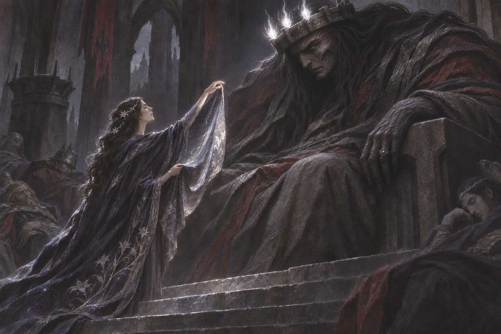

# The kinds of magic in Middle-earth

*Chapter 8 working notes for the First and Second Age RM2 sourcebook*

At her Mirror, Galadriel is puzzled that Sam uses the same word for what he is about to see and for the deceits of the Enemy. The distinction matters to the person looking into the water. Galadriel invites Sam to look, warns him of the limits of what he may learn, and leaves the choice with him. Sauron shows Gorlim the image of his missing wife because he knows what Gorlim will give to see her again. Two people see something extraordinary. Only one understands the terms on which he is seeing it. (*The Fellowship of the Ring*, “The Mirror of Galadriel”; [*The Silmarillion*, “Of Beren and Lúthien”](https://martijn.coppoolse.com/books/part/1226).)

In Letter 131 Tolkien describes much Elvish magic as art and asks what happens when a maker comes to desire dominion. In the unsent draft of Letter 155 he explores another distinction: *magia* produces effects in the physical world; *goeteia* concerns appearances and the imagination. Both sides can use both. These are two questions a GM can ask of the same deed: **what does it change, and what does its maker want of the people it touches?** [Letter 131](https://ldysinger.com/%40texts2/1938_jrr_tolkien/06_on_LOTR_letter_131.htm) and [draft Letter 155](https://tolkiengateway.net/wiki/Letter_155).

## Who can do this, and how?

A witness can often say how someone worked a wonder. Deciding who else could do it takes different evidence. For an RM2 character, that distinction matters as soon as a player asks to learn what they have seen.

| Where the ability lies | What the story lets us say |
|---|---|
| In the nature of a being | Sauron can change his bodily form as he struggles with Huan. A Maia's capacity to take shape helps explain that deed. Gandalf's kindling of fire shows something a Maia in the particular condition of an Istar can do. The incident alone tells us little about which other beings could learn it. (*The Silmarillion*, “Valaquenta” and [“Of Beren and Lúthien”](https://martijn.coppoolse.com/books/part/1226).) |
| In a lineage | Bear-shifting is said to persist for generations among Beorn's descendants. Here Tolkien actually traces a gift through a family. Its appearance among their forebears in a First or Second Age campaign would be our invention. [*The Hobbit*, “The Return Journey”](https://www.myths.com/pub/fiction/fantasy/Tolkien/Hobbit.html) |
| In a people's practice or a maker's art | The Dwarves at Bag End remember their forebears working spells at the forge. That locates an art in a community. Who might be taught, what a smith must practise, and what depends on a particular maker are separate questions. (*The Hobbit*, “An Unexpected Party.”) |
| In a particular person, place, or work | Lúthien brings her own voice and a cloak she made to Angband. Elrond has command of the river of his own valley. The West-gate of Moria will open even for a stranger who speaks the word. Each case gives a different answer when a player asks what they could carry away and use elsewhere. (*The Silmarillion*, “Of Beren and Lúthien”, and *The Fellowship of the Ring*, “Many Meetings” and “A Journey in the Dark.”) |

Record the **means** separately. Singing, speaking an oath, and striking metal describe what someone does. A song may carry a learned tradition, express a personal power, or move a listener who is free to answer. Finrod's disguise gives us evidence for what *Finrod* could do by singing. What a bard could teach an apprentice remains open.

## What characters actually encounter

These are working groupings for the sourcebook. They overlap. Song is a means of working, for example, and can serve healing, concealment, or mastery. The final column records questions for play. Third Age examples show a kind of working Tolkien depicts; its availability in an earlier Age remains a separate question.

| Kind of working | An example in Tolkien | Question for the table |
|---|---|---|
| Household and travelers’ spells | After the encounter with the trolls, the company buries the gold and puts spells over it. The narrator treats this as a sensible precaution and leaves the precise effect unstated. [*The Hobbit*, “Roast Mutton”](https://tolkiengateway.net/wiki/Roast_Mutton) | What would the person who laid such a spell expect it to do if someone found the cache? How certain are they that it worked? |
| Craft and virtue in an object | Narvi makes the West-gate of Khazad-dûm and Celebrimbor draws its signs. Long afterward, the right word still opens it. [*The Fellowship of the Ring*, “A Journey in the Dark”](https://www.encyclopedia-of-arda.com/d/doorsofdurin.php) | Who must understand the making? Who need only know the word? What happens when an enemy learns it? |
| Songs, words, and contests of will | Finrod sings to keep his companions’ identities concealed. Sauron answers him in song and brings the memory of the Kinslaying into the contest. Finrod loses; Sauron still has to discover whom he has captured. [*The Silmarillion*, “Of Beren and Lúthien”](https://martijn.coppoolse.com/books/part/1226) | What secret, memory, or claim gives the singer purchase? How much does victory actually reveal? |
| Works of protection and preservation | Melian guards the approaches to Doriath. In the Second Age the smiths of Eregion make the Three with the preservation of beauty in mind. A defended border and a place sheltered from the wear of time are different gifts. [Doriath and its Girdle](https://tolkiengateway.net/wiki/Girdle_of_Melian); [Letter 131](https://ldysinger.com/%40texts2/1938_jrr_tolkien/06_on_LOTR_letter_131.htm) | What will the traveler notice on crossing the boundary? On whose continuing presence or work does the protection depend? |
| Healing and restoration | Huan brings a herb to Lúthien, who tends Beren after Curufin wounds him. The deed needs someone to fetch the herb as well as someone who knows what to do with it. [*The Silmarillion*, “Of Beren and Lúthien”](https://martijn.coppoolse.com/books/part/1226) | Which help could an apprentice give? What might a healer perceive or accomplish that the apprentice cannot? |
| Speech with growing things | Treebeard recalls the Elves teaching trees to speak and learning their speech in turn. The Entwives tended plants that would grow according to their wishes. [*The Two Towers*, “Treebeard”](https://www.electroniclibrary21.ru/literature/tolkien/Index2-4.htm) | If a ranger asks an old tree about yesterday's travelers, what would the tree have noticed? How long would the answer take? |
| Far-seeing, foresight, and dreams | A palantír can show something real at a distance. Huor, facing death, foresees a star arising from his and Turgon’s lines. The first case has a device that another person can use; the second is a moment of insight whose meaning lies in the future. (*Unfinished Tales*, “The Palantíri”; [Huor’s words to Turgon](https://tolkiengateway.net/wiki/Huor).) | Can the seer choose what to look for? What does the player actually see or hear, and what remains theirs to interpret? |
| Bodily change and overt workings | Sauron changes shape in Huan’s grip. Much later, Gandalf kindles fire on Caradhras and knows the act may betray his presence. One deed depends on the nature of the being; the other leaves a signature a watcher might recognize. [“Of Beren and Lúthien”](https://martijn.coppoolse.com/books/part/1226); *The Fellowship of the Ring*, “The Ring Goes South.” | Could this character perform the deed at all? What would using it cost someone who needs to remain unknown? |
| Seeming, terror, and domination | Sauron deceives Gorlim with an image. His One Ring is a different undertaking: it is meant to give him mastery over other bearers. An error of judgment, terror in the presence of a wraith, and bondage of the will have different consequences for a character. [“Of Beren and Lúthien”](https://martijn.coppoolse.com/books/part/1226); [Letter 131](https://ldysinger.com/%40texts2/1938_jrr_tolkien/06_on_LOTR_letter_131.htm) | What can the victim doubt, resist, or refuse? At what point, if any, has the power to choose been taken away? |
| Oaths, curses, and dooms | At the end of the Second Age, the Men of the Mountains break their oath to Isildur. His curse endures until their obligation is fulfilled. [*The Return of the King*, “The Passing of the Grey Company”](https://tolkiengateway.net/wiki/The_Dead) | Who made a promise, before whom, and what would fulfil it? Could the same words have any force spoken by a stranger? |
| Dealings with the dead and necromancy | Gorlim comes to Beren in a dream to warn him. In “Laws and Customs among the Eldar,” Tolkien describes the peril of trying to master houseless Elvish spirits. A warning freely given and a necromancer’s summons give the dead very different parts in an encounter. [“Of Beren and Lúthien”](https://martijn.coppoolse.com/books/part/1226); [*Morgoth’s Ring*, “Laws and Customs among the Eldar”](https://b3.ewinerysolutions.com/assets/client/File/morgoths_ring.pdf). | Who initiated contact? What reason does the listener have to trust the speaker's identity or its message? |

## Overt magic in an encounter

Gandalf in the fir trees is a clear example of someone deliberately using visible magic in a fight. He sets cones burning in different colours and throws them among the Wargs. The next turn of the encounter matters: the goblins put the spreading fire to use against the company still trapped in the trees. [*The Hobbit*, “Out of the Frying-Pan into the Fire”](https://englishclubmskh.wordpress.com/wp-content/uploads/2014/06/the-hobbit-by-john-ronald-reuel-tolkien.pdf)

| Encounter | What witnesses could see | What made the deed possible? |
|---|---|---|
| Gandalf and the wolves west of Moria | Gandalf throws a burning branch into the air and speaks. Fire runs through the treetops; Legolas’s last arrow catches fire in flight. | Gandalf has a firebrand to hand. An archer already fighting beside him shares in the effect. (*The Fellowship of the Ring*, II.4, “A Journey in the Dark.”) |
| Finrod disguises Beren’s company | The company takes Orcish gear. Finrod sings, and their faces and shapes take on the likeness of Orcs. | Finrod can extend the disguise to his companions. They still have to behave convincingly when challenged. [*The Lay of Leithian*, Canto VIII](https://tolkienleithian.blogspot.com/2013/03/canto-viii.html) |
| Lúthien at Sauron’s stronghold | The gates fall and the pits holding the prisoners lie open. | Huan has overcome Sauron and Lúthien has secured his surrender of the tower. Only then does she undo the spell binding its stones. [*The Silmarillion*, “Of Beren and Lúthien”](https://martijn.coppoolse.com/books/part/1226) |
| Elrond and Gandalf at the Ford of Bruinen | A flood sweeps the Riders away. Frodo sees white riders on white horses in the advancing water. | Elrond commands the river of his valley. Gandalf gives some of the waves their visible forms. [*The Fellowship of the Ring*, II.1, “Many Meetings”](https://gwydionmadawc.com/57-about-tolkien/000-lord-of-the-rings-chapter-by-chapter/201-many-meetings/) |
| Sauron in the Last Alliance | Isildur records that the heat of Sauron’s hand killed Gil-galad. | This Second Age witness describes a property of Sauron’s embodied hand. He gives no casting procedure. (*The Fellowship of the Ring*, II.2, “The Council of Elrond.”) |

For play, what does an onlooker learn from witnessing a deed? The Wargs immediately know who is burning them. The guards who encounter Finrod’s company see the intended result and have to work out that any magic occurred. The reader can be certain about both workings while the people inside those scenes know quite different things.

### Lúthien sings Morgoth to sleep

In Angband, Morgoth sees through Lúthien's disguise. She gives her name and offers to sing for him. His desire to keep watching gives her time. As she sings, the fires go out and his court sleeps. The Silmarils blaze and his crown weighs his head down. Still singing, she casts her cloak before his eyes and lays a dream on him. Morgoth falls from his throne. Beren has time to cut one Silmaril free. [*The Silmarillion*, “Of Beren and Lúthien”](https://martijn.coppoolse.com/books/part/1226)

For a First Age game, the striking thing is how narrow Lúthien's victory can be and still change history. She needs Morgoth asleep for the time it takes Beren to act. Her voice, her own enchanted handiwork, and Morgoth's decision to hear her all matter. She is also the daughter of Melian and Thingol. How much another singer could learn from her is an open question. Compare her later song before Mandos. In Angband she imposes sleep. In the Halls of Mandos she moves someone to pity, and his answer is his own. [*The Silmarillion*, “Of Beren and Lúthien”](https://martijn.coppoolse.com/books/part/1226)

### Elrond, Vilya, and the white riders

Elrond is a healer and a seer in his own right. He finds and removes the sliver of the Morgul-blade working its way towards Frodo's heart. Years earlier he foretells an exceptionally long life for Aragorn and tells him what could cut that promise short. Those are distinct models for player professions. A healer can recognize a peril hidden inside a closing wound. A seer can speak truly about the future while the listener still has a choice to make. [*The Fellowship of the Ring*, “Many Meetings”](https://gwydionmadawc.com/57-about-tolkien/000-lord-of-the-rings-chapter-by-chapter/201-many-meetings/) and [Appendix A, “The Tale of Aragorn and Arwen”](https://www.theonering.com/a-part-of-the-tale-of-aragorn-and-arwen-a-short-story/)

At the Ford, Gandalf attributes command of the Bruinen to Elrond. Elrond bears **Vilya**, while Galadriel bears **Nenya**. Tolkien says the Rings could enhance powers their bearers already possessed. That gives us grounds to play Vilya as strengthening Elrond's defence of Imladris. How much it contributes to this particular flood is left unstated. [“Many Meetings”](https://gwydionmadawc.com/57-about-tolkien/000-lord-of-the-rings-chapter-by-chapter/201-many-meetings/), [“The Grey Havens”](https://tolkiengateway.net/wiki/Vilya), and [Letter 131](https://ldysinger.com/@texts2/1938_jrr_tolkien/06_on_LOTR_letter_131.htm)

Frodo thought he saw mounted figures, and Gandalf tells him that some of the waves took those shapes through his intervention. That is a precedent for deliberate image-making, one sense of **illusion**. For RM2, a rider who recognizes Gandalf's artistry still faces a flooded crossing. Recognizing the image of his wife as a deception might have saved Gorlim from betraying Barahir. What a character can do with that recognition matters when choosing whether to call for a resistance roll. [“Many Meetings”](https://gwydionmadawc.com/57-about-tolkien/000-lord-of-the-rings-chapter-by-chapter/201-many-meetings/) and [“Of Beren and Lúthien”](https://martijn.coppoolse.com/books/part/1226)

## Oaths, curses, and the Paths of the Dead

The King of the Mountains swears allegiance to Isildur upon the Stone of Erech. Later, when Isildur calls on the Men of the Mountains to fight Sauron, they refuse. Isildur then declares that if the West prevails, they will find no rest until they fulfil their oath. The king made the promise. The wronged party spoke the curse. Much later, Aragorn can name the outstanding service, accept it as Isildur's heir, and dismiss the Dead at Pelargir. The terms of the bond are recoverable even though the ultimate source of its force remains mysterious. [*The Return of the King*, “The Passing of the Grey Company”](https://roachpuncher.substack.com/p/return-of-the-king-book-5-chapter) and [“The Last Debate”](https://esl-bits.eu/ESL.English.Learning.Audiobooks/3%20LOTR/09/text.html)

A seer's foretelling enters the same story. Malbeth foresees an heir taking the Paths of the Dead. Knowing his words can help Aragorn decide where to go. Isildur's words centuries earlier determine what the Dead still owe. For an adventure, record who pledged what, who can call the debt due, and what act could discharge it. A player who discovers the original terms has learned something they can act on. Whether kingship, the broken oath itself, or some higher sanction gives a curse this reach can remain open. [*The Return of the King*, “The Passing of the Grey Company”](https://roachpuncher.substack.com/p/return-of-the-king-book-5-chapter)

## Where a spell list may be the wrong starting point

**Native spiritual presence.** Frodo's sight of Glorfindel at the Ford depends on what Glorfindel is and what is happening to Frodo. Nothing in the scene requires Glorfindel to cast a spell to become visible to him. Let Chapter 6 explore how an observer comes to perceive the Unseen. [*The Fellowship of the Ring*, “Many Meetings”](https://tolkiengateway.net/wiki/Unseen)

**Petition, worship, and providence.** The ruler of Númenor offers prayers to Eru on the Meneltarma. In the First Age, Lúthien moves Mandos with her song and appeals on Beren’s behalf. These are grounds for asking whom a devotee addresses, what authority the one addressed possesses, and who decides the outcome. A repeatable profession list for a devotee of a Vala or Morgoth would be our adaptation. (*Unfinished Tales*, “A Description of the Island of Númenor”; [*The Silmarillion*, “Of Beren and Lúthien”](https://martijn.coppoolse.com/books/part/1226).)

**The maker’s investment.** Fëanor’s work on the Silmarils and Sauron’s work on the One both raise the question of how much of oneself can pass into a work. They give different answers about what endures and what can be lost. Chapter 10 takes up that cost. [“Of the Flight of the Noldor”](https://martijn.coppoolse.com/books/part/1216/of-the-flight-of-the-noldor); [Letter 131](https://ldysinger.com/%40texts2/1938_jrr_tolkien/06_on_LOTR_letter_131.htm)

## A test case for the enchanter

At Bag End, the Dwarves sing about spells their forebears worked as their hammers fell (*The Hobbit*, “An Unexpected Party”). In *The Lay of Leithian* we can even name an object made this way. The smiths of Nogrod sing enchantments while forging the steel knife Beren takes from Curufin, later named Angrist. Its edge can cut iron. What the smiths had to sing, and whether an apprentice who knew the words could make a second such blade, are questions for the campaign. [*The Lay of Leithian*, lines 3054–3060, and the later naming of Angrist](https://www.silmarillionwritersguild.org/node/5499)

One smith might sing to hear a flaw in the metal, then change the next hammer blow. Another might sing while making a hinge that will turn silently for centuries. In the first case the gift operates through the smith’s judgment; in the second, someone born centuries later benefits from the work. The same tradition could encompass both. Which parts can a teacher pass on? What could a player discover by watching a smith at work? Those questions can stay open while we collect more examples.
